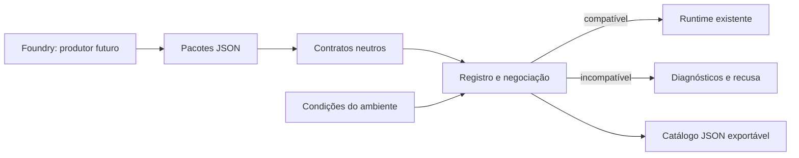

# Incremento 4 — Registro de capacidades

Implementação local sobre o checkpoint `a7ec750`, branch `main`, em 2026-10-10.
O Incremento 5 permanece pendente. Não houve commit, deploy, migração ou seed nesta execução.

## 1. Diagnóstico confirmado antes da implementação

A baseline possuía contratos, avaliações explícitas, políticas declarativas e proteção
da sincronização. O commit do checkpoint estava presente; esses incrementos foram
reutilizados. As lacunas confirmadas foram:

- `LanguagePackage.capabilities` juntava voz, variantes e traços como tons/gênero.
  Esses booleanos não provavam suporte do motor.
- `activity.payload` era genérico; o runtime validava uma segunda definição das
  estruturas. `evaluation.strategy` era aceito e depois perdido na conversão.
- `publicCourse()` removia atividades indisponíveis da lista. A política conhecia
  seus IDs, mas o aluno não encontrava a atividade correspondente.
- Não havia negociação de versões/requisitos nem catálogo de implementações.
- Referências `activity.media` eram verificadas no loader, mas não convertidas
  em reprodução no runtime.

### Inventário de implementação

Os caminhos abaixo são evidências do código, não afirmações de qualidade pedagógica
ou de disponibilidade dos serviços externos.

| Recurso | Classificação e evidência |
| --- | --- |
| Conteúdo, flashcard, revisão guiada, marcador quiz | Implementado e verificável: `activity-renderer.tsx`. Quiz produz participação; não é uma avaliação final. |
| Múltipla escolha, verdadeiro/falso, lacuna, resposta curta, ordenação, questão de escuta | Implementado e verificável: `grader.ts`, `exercise-card.tsx`, `activity-data.ts`. Ordenação usa tokens fornecidos e espaços; não segmenta qualquer escrita automaticamente. |
| Escrita e entrega de texto | Implementado e verificável: `writing-editor.tsx`, `study-state.ts`. Entrega não inventa uma nota objetiva. |
| Avaliações diagnósticas, formativas e somativas, fixas/adaptativas | Implementado e verificável: `assessment-engine.ts`, `assessment-api.ts`, runners e persistência homologada localmente. Finalidade e método são dimensões separadas. |
| Conclusão/domínio estimado | Implementado e verificável: `learning-policy-engine.ts`, `learning-policies.ts`, `unit-progress-projection.ts`. Critérios continuam finitos e declarativos. |
| Revisão espaçada | Implementado e verificável: `review-scheduler.ts`, `review-card.ts`, verificadores de aprendizagem. |
| Gravação e transcrição manual | Implementado com dependência do dispositivo/permissão: `speaking-recorder.tsx`. Independe de um serviço de reconhecimento. |
| TTS | Implementado com dependência do navegador/locale: `speak-text.ts`, `speech-voice-preference.ts`. Não garante voz uniforme entre dispositivos. |
| Reconhecimento de fala e pronúncia com referência | Implementado com dependência do provedor/locale: `transcribe-speech.ts`, `/api/pronunciation`. Sem chamada paga nesta homologação. |
| Tutor, feedback de escrita, conversa livre/guiada, microlição, descrição de imagem, apoio à aula | Implementado com dependência de configuração/provedor: `OpenAIProvider`, schemas de resposta e rotas correspondentes. Correção contextual e citações não constituem domínio certificado. A descrição usa fatos autorados; não reinterpreta a imagem em cada tentativa. |
| Aula particular: timeline, quadro, checkpoints, pausa/retomada | Implementado e verificável: `interactive-lesson/runtime.ts`, `InteractiveClassroom`, API de sessões. Requer armazenamento autenticado. A adaptação curricular automática completa permanece parcial e não é anunciada pelo registro. |
| Dicionário, alfabeto, comparações regionais | Implementado e verificável: `dictionary-search.ts`, `AlphabetGuide`, `RegionalGuide`, schemas dos módulos. Áudio adicional usa capacidades de voz separadas. |
| Exibição de números | Implementado: `NumberGuide`, `numbersModuleSchema`. |
| Correção/prática universal de números | Parcial: `number-practice.ts` aceita notações limitadas, dígitos ASCII e determinadas moedas/ordinais. `numbers.dictation` é explicitamente parcial e não satisfaz requisito obrigatório. A tela existente continua funcionando nesse alcance. |
| Matching | Apenas declarado no enum antigo da persistência; sem contrato/renderer/executor atual. Não consta como suportado. |
| `AIProvider.evaluateSpeaking()` | Declaração sem implementação: o método lança erro. Não é o executor de pronúncia e não foi anunciado. |
| Tons, romanização, sistemas de escrita, RTL | Características representáveis. Não há implementação específica de avaliação tonal, romanização ou layout RTL universal. Requisitos dessas capacidades desconhecidas são recusados. |
| Rubrica externa configurável, importador completo, adaptação curricular automática | Não implementados como capacidades públicas executáveis neste incremento. |

O contrato aceita nove IDs de habilidade como metadados. Runtime/persistência têm
seis habilidades principais, agora representadas por `coreSkillSchema`. Uma atividade
com apenas `fluency`, por exemplo, é recusada antes de projetar um progresso sem
habilidade principal. Metadados adicionais não provam um pipeline de nota independente.

## 2. Arquitetura e fontes de verdade



- `src/content/capability-contracts.ts`: declaração de requisito/alternativa,
  versões e resultados tipados. Não importa UI, banco, preferências ou provedores.
- `src/content/activity-data.ts`: schemas de payload usados pelo runtime e pelo
  registro. Normalização e tipos continuam exportados por `contracts.ts` para
  compatibilidade dos imports. Não existem duas definições do mesmo payload.
- `src/engine/capabilities/registry.ts`: tabela central, schema, suporte, mecanismo,
  apresentação, evidências, restrições e dependências. São **37 entradas**, sendo
  **36 implementadas** e **uma parcial**. Configuração permanece uma dimensão distinta.
- `compatibility.ts`: negociação pura. `package-compatibility.ts`: requisitos
  explícitos e requisitos obrigatórios derivados dos elementos nativos.
- `availability-projection.ts`: mesma resolução de escopos no servidor/dispositivo.
  IDs/locais são preservados mesmo quando uma unidade inativa é filtrada.
- `capability-environment.ts`: adaptador do servidor. Retorna condições, sem valores
  de credenciais. Uma credencial presente gera estado **desconhecido**, pois não
  comprova saúde, permissões, modelo ou cota do serviço.
- `client-capabilities.ts`: detecta APIs de áudio no navegador após hidratação,
  sem solicitar microfone automaticamente. A permissão efetiva continua no ato
  de gravar. A projeção visível não reinicia o controlador de sincronização.

O registro contém referências internas a implementações estáticas; não importa nem
executa código fornecido pelo produtor. O verificador AST confere arquivos, exports,
métodos, corpos ausentes/que apenas lançam erro, dependências, ciclos, schemas e
branches dos tipos de atividade. Não é um framework de plugins nem uma prova
formal da qualidade semântica de cada implementação: testes de comportamento e
revisão de alterações continuam necessários.

### Compatibilidade

Cada capacidade usa uma lista explícita de versões aceitas. Neste catálogo, a
versão é `1.0.0`; `1.0.1`, `1.1.0` e `2.0.0` não são aceitas automaticamente.
Dependências internas deste catálogo exigem `1.0.0` também.

O relatório contém `compatible`, `readiness`, `diagnostics` e `selections`.
`readiness` pode ser `ready`, `unavailable` ou `unknown`. Um conteúdo incompatível
pode não ter impedimentos operacionais; isso não autoriza execução. Primeiro deve
ser compatível. Condições ainda desconhecidas precisam ser verificadas no ambiente
correspondente; uma condição confirmadamente indisponível bloqueia a operação.

Recurso opcional exige uma alternativa conhecida, implementada, com versão, dados
e dependências estruturais válidos, mesmo se o primário estiver disponível agora.
Se a alternativa estiver temporariamente indisponível, isso não vira incompatibilidade
estrutural: o primário saudável pode continuar; se apenas a alternativa atender ao
contrato, o resultado permanece compatível e a execução fica indisponível. A negociação
registra a alternativa selecionada. Requisitos são manifestos de compatibilidade:
não são roteiros executáveis nem substituem automaticamente o currículo. Elementos
nativos e critérios pedagógicos continuam obrigatórios; uma alternativa não cria
evidências nem dispensa uma avaliação/entrega exigida pela política.

## 3. Integração e decisões

### Contratos de língua e curso

`LanguagePackage` passa a schema **1.1**:

- `writingSystem` e `linguisticFeatures` descrevem características.
- `speech.support` descreve cobertura configurável da língua/variante; não prova
  implementação ou saúde do serviço.
- `capabilityRequirements` declara necessidades do motor.
- `normalization` continua declarativa.

Os três manifests e consumidores próprios foram atualizados juntos. O bloco
misturado `capabilities` e os nomes de estratégias não executadas foram removidos.
O schema 1.1 é estrito: não aceita silenciosamente esses campos antigos. A API de
voz e as preferências mantêm os valores e locales anteriores. Ausência de configuração
ou locale deixa de ser rejeição estrutural do loader: o adaptador operacional
informa a indisponibilidade no ambiente selecionado.

`CoursePackage` permanece no schema experimental **1.3**, com adição opcional de
requisitos no curso, unidade, lição, atividade e avaliação. Esse contrato ainda
não foi publicado como V1 estável para um produtor externo. A mudança de schema
da língua é explícita; não houve migração de alunos/banco nem um adaptador legado
permanente. Um produtor antigo precisará adaptar o manifesto antes da validação.

### Compilação, runtime e interface

`runtimeBundle()` valida compatibilidade antes de criar o curso executável.
Atividades, estratégias de correção, avaliações, políticas, módulos e aulas
interativas geram requisitos nativos. Requisito obrigatório desconhecido ou parcial
causa `CapabilityCompatibilityError` com relatório estruturado.

Referências de áudio de escuta são convertidas para o payload que `AudioPlayer`
realmente usa. Referência desconhecida, mídia não apresentada pela interação ou
conflito entre áudio inline e referência são recusados. Recurso de mídia pode ter
disponibilidade disponível/indisponível/desconhecida fornecida pelo ambiente;
não se presume que um URL sempre responda. O loader já verifica arquivos locais;
checagem contínua de entrega/serviços não foi acrescentada.

`publicCourse()` conserva atividades indisponíveis e fornece suas razões. Renderer
apresenta um impedimento, sem botão de conclusão. Políticas recebem IDs indisponíveis
e continuam distinguindo pendência, indisponibilidade, insuficiência e reprovação.
As APIs de correção, avaliação, ativação e sessão verificam impedimentos aplicáveis
antes de produzir novos resultados/gravações. A tela de avaliação e a aula particular
apresentam o bloqueio correspondente; leitura do histórico é preservada.

### Privacidade e persistência

Requisitos podem conter dados canônicos ou de alternativa com gabaritos. Esses
payloads ficam no pacote privado e são removidos da projeção de SSR, do perfil
de língua enviado ao aluno e das definições públicas. A inspeção do seed revelou
um segundo caminho de exposição potencial: requisitos aninhados em tabelas públicas.
`activitySeedPayload()` e `assessmentSeedRows()` agora também removem esses dados.
O teste injeta um marcador privado em todos os escopos e verifica ambas as fronteiras.

O runtime segue usando os pacotes compilados como fonte de conteúdo. Tabelas
relacionais são projeções; não foi implementado carregamento completo de um pacote
a partir delas. Não foi executado seed nesta etapa. Não há migração SQL nova.
A sincronização/evidências dos alunos mantêm o modelo dos incrementos anteriores.

### Preparação para o Foundry

O catálogo portável está em `contracts/engine-capabilities-v1.json`, gerado por
`npm.cmd run capabilities:catalog`. Inclui schema dos requisitos, schemas dos dados,
versões, evidências, dependências e restrições. Não inclui instâncias de gabarito,
paths privados, código, chaves ou disponibilidade de uma instalação específica.
O teste compara o artefato com sua geração, evitando uma segunda fonte manual.
Sem API DLF, interface administrativa ou importador completo.

## 4. Validação e resultados

### Automático

| Verificação | Resultado |
| --- | --- |
| `capabilities:verify` | **31 cenários** aprovados: compatibilidade, versões, alternativas, executor ausente/stub, dependências/ciclos, payload/semântica, mídia, todos os escopos, privacidade, políticas, API sem gravação, dispositivo e idioma sintético. |
| `contracts:verify` | Valores, tipos/consumidores e **24 regressões** arquiteturais negativos preservados; grafo neutro de cinco módulos. |
| `sync:verify` | **13 cenários** de integridade preservados. |
| `assessment:semantics:verify` | **23 cenários** aprovados. |
| `policies:verify` | **24 cenários** aprovados. |
| `assessment:verify` | 1.024 caminhos ES, 1.024 EN e oito sintéticos aprovados. |
| Multilíngua, aprendizagem, onboarding, aulas interativas, tempo de sessão | Aprovados. |
| Conteúdo/compilação | Três pacotes, 46/23/7 atividades. |
| Triagem pedagógica | Zero erros; dois avisos preexistentes de alternativas equivalentes (`grammar-5`, `review-4`). |
| Arquitetura | Contratos sem infraestrutura/UI/provedores; registro sem ciclos, schemas compartilhados e bindings reais verificados. |
| TypeScript e ESLint | Aprovados, sem novos erros/warnings. |
| `checkpoint:verify` | **13 cenários** reais aprovados: auth/MFA/RLS, persistência/releitura, políticas, recuperação de leitura/gravação, respostas obsoletas, storage e navegador. |
| `build:local` | Aprovado com Next.js 16.3.8 e TypeScript. |

O checkpoint foi executado com projeto Docker `espanhol-plataform`, daemon
`desktop-linux` local, Supabase `http://127.0.0.1:54321` e app
`http://127.0.0.1:3000`. O navegador acessou apenas essas origens: zero requests
externos bloqueados e zero erros de runtime. Sem overflow em 390 e 360 pixels.
As duas contas sintéticas e o objeto próprio foram removidos pelo teste.

Nas primeiras regressões, um teste de aula usava uma língua diferente para
simular ausência de reconhecimento. Foi corrigido para verificar mistura de
línguas e distinguir gravação manual de reconhecimento. Outro teste dependia
de flags de IA habilitadas: a suíte offline recebeu flags próprias e nenhuma
chave de IA. O perfil real/local do app não foi alterado por esse ajuste.

### Invariantes comprovados

1. Declaração de traço ou cobertura de voz não cria suporte do motor.
2. Requisito obrigatório desconhecido, versão não listada, implementação parcial
   e dados incompatíveis não ativam um pacote.
3. Alternativa insuficiente não transforma um requisito em sucesso.
4. Indisponibilidade não gera nota zero, conclusão ou evidência fictícia.
5. Requisitos permanecem no runtime; payloads privados não permanecem nas fronteiras públicas.
6. Políticas/finalidades de avaliação e regras de sincronização continuam preservadas.
7. Nenhum código externo é carregado; nenhum serviço pago é usado nos testes.

### Manual e limites conhecidos

- Rever o texto e a jornada dos impedimentos em aparelhos reais, incluindo toque,
  leitor de tela, teclado virtual e permissão negada/revogada de microfone.
- Saúde, cota, permissão e compatibilidade do modelo/locale de serviços externos
  não foram comprovadas por chamadas reais. Credenciais configuradas continuam
  com disponibilidade desconhecida até a operação/probe correspondente.
- Vozes instaladas e entrega de mídia podem mudar depois da validação. Os handlers
  existentes tratam erros de execução; o registro não é um monitor contínuo.
- O adaptador de servidor usa a variante fornecida ou a padrão; handlers de fala
  continuam conferindo a variante efetiva do aluno. Não houve substituição completa
  dos mapeamentos de provedor do perfil linguístico por configuração externa.
- Não existe dispatcher genérico que transforme qualquer requisito em uma atividade.
  Seleções são negociações de capacidades existentes, não execução de scripts do produtor.
- Números universais, segmentação especializada, RTL completo, análise tonal,
  rubricas externas e adaptação curricular completa continuam sem suporte anunciado.
- Concorrência entre dispositivos, atomicidade de snapshot/projeções e certificação
  de evidências permanecem fora deste incremento.

## 5. Aprendizado: Capability-Based Architecture

### 1. O que é uma capacidade?

É uma operação que o consumidor consegue solicitar sob um contrato conhecido.
`grading.exact-normalized@1.0.0` compara uma resposta aos gabaritos canônicos com
normalização declarada. O nome representa comportamento verificável, não uma
flag solta nem o nome de um provedor.

### 2. Capacidade, configuração, política e característica

| Categoria | Exemplo desta implementação |
| --- | --- |
| Característica | `writingSystem.direction`, `linguisticFeatures.tones`. |
| Capacidade | `activity.ordering`, `speech.pronunciation`, `assessment.fixed`. |
| Política | Exigir duas entregas ou nota mínima em uma avaliação explicitamente referenciada. |
| Condição/configuração | API de gravação presente, serviço de voz configurado, locale existente, mídia disponível. |

Uma língua tonal não implementa um avaliador tonal. Um locale não comprova que
o serviço respondeu. Um serviço funcionando não decide qual nota aprova o aluno.

### 3. Por que declaração não comprova implementação?

`AIProvider.evaluateSpeaking()` existe como assinatura e corpo que lança erro.
Um catálogo baseado só na assinatura anunciaria suporte falso. O registro usa
o handler de pronúncia realmente implementado; o verificador rejeita o stub.
Schemas de dados também não implementam o comportamento de execução.

### 4. Versão e disponibilidade

Um requisito de versão `2.0.0` para um executor `1.0.0` é incompatível mesmo com
credenciais válidas. Um executor `1.0.0` sem serviço configurado é compatível
estruturalmente e indisponível operacionalmente. As soluções diferem: adaptar
o contrato ou configurar/restaurar o ambiente.

### 5. Como o registro reduz acoplamento?

O produtor fornece IDs/versões/dados. Os contratos não conhecem React, tabelas ou
Azure/OpenAI. O motor associa IDs a seus mecanismos internos, verificando essa
direção por AST. Trocar infraestrutura não exige colocar suas credenciais no curso.

### 6. Como ocorre negociação?

Antes do runtime, a validação compara requisitos com o registro, verifica dados,
semântica, dependências e alternativas. Depois o servidor/dispositivo adiciona
condições operacionais. O resultado descreve seleção e impedimentos; não inventa
um executor nem uma nota para preencher a lacuna.

### 7. Por que validar antes?

Um pacote que exige `speech.tonal_assessment` é recusado por `runtimeBundle()` antes
de expor uma aula impossível. O produtor recebe `CAPABILITY_UNKNOWN`, localização,
versão e orientação. Isso evita instalar conteúdo que só falharia depois que o
aluno chegasse a uma atividade obrigatória.

### Experimento executável

Execute `npm.cmd run capabilities:verify`. O segundo cenário adiciona ao curso
sintético uma capacidade obrigatória desconhecida e confirma que nenhuma conversão
executável acontece. Outro cenário muda um requisito para `speech.tonal_assessment`
e comprova que o traço `tones: true` não o torna implementado.

Um cenário válido solicita `activity.multiple_choice@1.0.0` com opções/gabarito
compatíveis. A negociação aceita; o teste executa a correção real de uma questão
sintética e confirma o resultado. Um terceiro experimento deixa uma avaliação
operacionalmente indisponível: a API devolve 503 e a função simulada de persistência
é chamada **zero vezes**.

### 8. Uso fora do ensino

Um gateway pode anunciar captura/estorno com contratos e moedas aceitos;
um ERP pode anunciar importação de pedidos com determinada versão; um marketplace
pode anunciar catálogo/estoque. O consumidor negocia a capacidade, e configuração,
credenciais e saúde continuam verificações separadas. Uma alternativa só pode ser
selecionada quando houver um mecanismo válido para ela.

### 9. Quando seria complexidade desnecessária?

Em uma aplicação pequena com um único fluxo fixo e sem produtores independentes,
uma função tipada e validação de entrada podem bastar. Aqui existem muitos recursos,
pacotes independentes e um produtor futuro que precisa saber o que é executável.
A tabela estática resolve essa necessidade sem descoberta dinâmica ou plugins.

### 10. Como os testes limitam anúncios incorretos por agentes?

Eles recusam falta de executor, arquivo/método ausente, stub, versão não aceita,
dependência ausente/cíclica, schema divergente e payload que a interação não usa.
Fixtures também executam correção, projeção, políticas e API reais/simuladas.
Um agente não pode entregar apenas uma linha de catálogo e tratar isso como prova.
O AST não avalia sozinho qualidade pedagógica ou semântica completa: esses aspectos
precisam de testes próprios e revisão humana.

## 6. Próximos passos para revisão

- Revisar o catálogo e a evolução explícita do perfil linguístico 1.1.
- Consolidar o contrato público completo, referências de alternativas/recursos,
  publicação/versionamento e política de confiança no produtor.
- Definir instalação transacional e validação editorial independente quando o
  importador for autorizado, sem usar tabelas públicas para transportar gabaritos.
- Preparar testes de provedores e dispositivos autorizados, separados da suíte
  offline e sem confundir confiança de IA com evidência certificada.

Esses pontos não foram implementados como Incremento 5. Esta entrega fica para
revisão e autorização posterior.

## 7. Arquivos desta entrega

67 arquivos de codigo, conteudo, catalogo e documentacao; lista derivada do diff contra a7ec750. Nenhum staging/commit. O workspace pessoal e variacoes geradas de next-env.d.ts ficam fora do escopo.

```text
DESTRAVA_ARQUITETURA_MULTILINGUA.md
DESTRAVA_CAPACIDADES_INCREMENTO_4.md
DESTRAVA_CONTRATOS_MULTILINGUA_V1.md
DESTRAVA_DIRECIONAMENTO_ARQUITETURAL.md
README.md
content/languages/en/manifest.json
content/languages/es/manifest.json
content/languages/xx-Test/manifest.json
contracts/engine-capabilities-v1.json
package.json
scripts/capability-implementation-check.ts
scripts/check-architecture.ts
scripts/content-loader.ts
scripts/content-pedagogy.ts
scripts/content-preview.ts
scripts/contract-dependency-check.ts
scripts/export-capability-catalog.ts
scripts/seed-supabase.ts
scripts/verify-assessment-semantics.tsx
scripts/verify-capabilities.tsx
scripts/verify-interactive-lessons.ts
scripts/verify-learning-engine.ts
scripts/verify-learning-policies.tsx
scripts/verify-multilingual.ts
src/app/api/course/active/route.ts
src/app/api/grade/route.ts
src/app/api/interactive-lessons/session/route.ts
src/app/api/pronunciation/route.ts
src/app/assessment/page.tsx
src/app/describe/page.tsx
src/app/layout.tsx
src/app/live-classes/page.tsx
src/app/settings/page.tsx
src/components/activities/activity-renderer.tsx
src/components/activities/adaptive-assessment-runner.tsx
src/components/activities/fixed-assessment-runner.tsx
src/components/audio/selection-audio.tsx
src/components/audio/speak-button.tsx
src/components/conversation/conversation-voice-input.tsx
src/components/interactive-lesson/interactive-classroom.tsx
src/components/layout/app-shell.tsx
src/components/numbers/number-practice.tsx
src/components/study-provider.tsx
src/content/activity-data.ts
src/content/activity-media.ts
src/content/capability-contracts.ts
src/content/contract-vocabulary.ts
src/content/contracts.ts
src/content/generated/packs/frecuencias-a1.json
src/content/generated/packs/pt-BR.en.a1.general.json
src/content/generated/packs/pt-BR.xx-Test.a1.general.json
src/content/public.ts
src/content/runtime-package.ts
src/content/schema.ts
src/content/validate-interactive-lessons.ts
src/domain/activities/grader.ts
src/domain/study/learning-policy-engine.ts
src/engine/capabilities/availability-projection.ts
src/engine/capabilities/compatibility.ts
src/engine/capabilities/package-compatibility.ts
src/engine/capabilities/registry.ts
src/lib/assessment-api.ts
src/lib/capability-environment.ts
src/lib/client-capabilities.ts
src/lib/transcribe-speech.ts
src/repositories/activity-content-projection.ts
src/repositories/assessment-content-projection.ts
```
