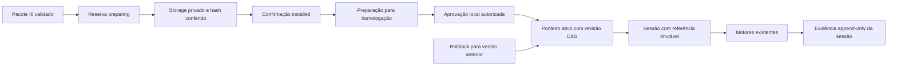

# Destrava Incremento 7 Instalações Versionadas

Baseline de trabalho: `b34915d6cc9a0311fa10e36e400512bead109527`, checkpoint dos 11 arquivos multiagente; pai `0e2c988` do Incremento 6. Branch do Lead: `feat/increment-7-versioned-installations`. Implementador e QA estão em worktrees distintas, alinhadas à mesma baseline após preservar suas entregas anteriores em backups com hashes. Não houve reset/limpeza destrutiva.

## A. Execução multiagente

| Responsável | Escopo de escrita | Dependências |
| --- | --- | --- |
| Implementador | `src/domain/course-installations/`, adapter Supabase e migração `20261010000300_course_installations.sql` | Contratos internos congelados antes da lógica. |
| QA | Verificadores novos de instalações, integração local e fixtures sintéticas | Requisitos do usuário e contratos; não lê implementação antes de derivar testes. |
| Lead | Issuer local, runner protegido, resolução server, rotas/sessões/mídia/avaliações e documentação | Ports do Implementador; somente Lead aplica migração no banco local. |
| Revisor | Análise de ameaças e revisão final do candidato | Apenas leitura, com fiscalização de hashes; nenhuma correção direta. |

Perfis foram carregados explicitamente com contexto delimitado. Não há alegação de sandbox read-only específico. Instalação de dependências nas duas worktrees usou `npm ci --offline --ignore-scripts --no-audit --no-fund`, com o lockfile existente e sem rede ou nova dependência.

Agentes nativos: `/root/implementador_i7`, `/root/qa_i7` e `/root/revisor_i7`, coordenados pelo Lead `/root`. Nenhum especialista subdelegou. Comunicação usou mensagens/followups nativos; entregas seguiram os dez campos definidos em `DESTRAVA_MULTIAGENTE.md`. Cada delta teve escopo, baseline, preimage e SHA conferidos antes de `git apply --check`/integração, preservando LF/CRLF com `core.autocrlf=false` por comando. Não houve conflito de merge; alterações dos testes foram feitas pelo QA, e correções de SQL/adapter pelo Implementador.

## B. Implementação e invariantes

1. Course ID, content version, versões de contratos, installation ID e artifact hash são identidades distintas.
2. Artefato contém os bytes exatos de manifesto, documentos, módulos e recursos, com inventário canônico ordenado. Buffers externos são copiados antes do primeiro await.
3. Mesmo curso/versão/hash é idempotente; mesmo curso/versão com outros bytes conflita. Versões anteriores e seus critérios não são sobrescritos.
4. Reserva, upload/verificação e confirmação são etapas separadas; banco e Storage não são considerados uma transação única. Falhas mantêm preparação recuperável, sem publicação.
5. Instalação, preparação para homologação, aprovação local e ativação são estados separados. Manifesto editorial não fornece autoridade.
6. Publicação real é negada por padrão. Mutações privilegiadas exigem autoridade externa ao pacote; o emissor de teste exige prova positiva de Docker/projeto/workspace/loopback e nega modo produção.
7. Ponteiro ativo, revisão monotônica e histórico/receipt mudam juntos em RPC transacional. CAS rejeita decisão obsoleta; retry de operação aplicada retorna receipt sem reaplicá-la.
8. Sessão captura instalação/hash/versão e revisão de forma atômica. Execução/correção/histórico e recursos resolvem a sessão original, não o ponteiro corrente.
9. Evidências são append-only e ligadas à sessão/definição/instalação; rollback não remove dados nem reclassifica notas antigas.
10. Artefatos e gabaritos ficam privados. A rota de mídia só entrega binários declarados, para sessão do usuário autenticado, após integridade.
11. Importador I6, runtimeBundle, capacidades, projeção pública, grader e avaliador existentes são reutilizados. Não há segundo motor nem seed de versões nos IDs globais antigos.
12. Cache pode guardar conteúdo imutável por identidade/hash; escolha da versão ativa consulta o catálogo persistente. Erro de leitura não autoriza fallback silencioso.

## Decisões de integração

Snapshots completos vão para bucket privado `course-artifacts`; metadados e transições ficam no catálogo Supabase. A identidade dos objetos inclui instalação/hash. Não duplicar conteúdo completo nas tabelas de metadados nem reutilizar o bucket mutável das gravações dos alunos.

O domínio recebe ports `ArtifactStore`, `InstallationCatalog` e `AuthorizationGuard`; o authorizer padrão nega mutações. O issuer de teste não é exposto em rota HTTP e exige prova local. O gate de SQL fica em schema privado, bloqueado por padrão e configurável somente pelo owner no programa local protegido. RPCs privilegiadas são limitadas a `service_role`.

A resolução instalada é assíncrona no servidor; o catálogo compilado continua sendo o caminho explícito para os cursos incorporados quando não existe selector de sessão instalada. A seleção fornecida, inclusive vazia/inválida, não retorna silenciosamente conteúdo compilado/corrente. Integrações de UI ou serviços não generalizados nesta etapa têm limites explícitos; não há suporte dinâmico completo anunciado.



O rollback modifica `V`, não `T` ou `D`. A confirmação `I` só ocorre após os bytes completos existirem e serem conferidos. Nenhuma seta do pacote para aprovação ou publicação concede autoridade.

### Arquivos e responsabilidades

| Grupo | Arquivos novos ou alterados |
| --- | --- |
| Domínio e ports | `src/domain/course-installations/{contracts,artifact,service}.ts` |
| Persistência | `src/repositories/supabase-course-installations.ts`; `supabase/migrations/20261010000300_course_installations.sql` |
| Gestão local | `scripts/course-installation-local-authority.ts`; `scripts/run-course-installations-local.mjs`; `scripts/manage-course-installations-local.ts`; scripts no `package.json` |
| Runtime/API | `src/lib/course-installation-runtime.ts`; `src/lib/assessment-api.ts`; `src/content/assessment-results.ts`; rotas `api/course-installations/{sessions,media,policies}`, `api/grade`, `api/assessments` |
| Fronteiras não adaptadas | `src/lib/versioned-operation-guard.ts`; `src/domain/ai/ai-request-guard.ts`; rotas `api/interactive-lessons/session`, `api/pronunciation`, `api/ai/conversation/transcribe`, `api/ai/image-description` |
| Inspeção | `src/app/installed-courses/[sessionId]/page.tsx`, reutilizando `AudioPlayer` |
| QA | `scripts/course-installation-test-fixtures.ts`; `scripts/verify-course-installations.tsx`; `scripts/verify-course-installations-local.tsx` |
| Documentação canônica | Links/estado em `README.md`, `DESTRAVA_ARQUITETURA_MULTILINGUA.md`, `DESTRAVA_MULTIAGENTE.md`; este relatório registra decisões/evidências, sem redefinir contratos públicos. |

`ArtifactIdentity` não é `InstalledContentReference`: a segunda acrescenta o UUID da instalação. O hash é SHA-256 de `JSON.stringify({ format: "destrava.immutable-artifact/1", files: inventarioOrdenado })`; cada entrada possui path, tamanho e SHA-256 dos bytes. Manifesto também participa, portanto até alteração só de proveniência exige outra versão. Contratos de conteúdo/idioma/envelope são identificados separadamente e continuam provenientes dos schemas do Incremento 6.

Catálogo registra origem, requisitos públicos, relatório público de validação, inventário, estados e datas, sem duplicar documentos completos. Curso/versão é único; o snapshot completo fica apenas no Storage. Sessões fixam referência/revisão; evidências fixam sessão/definição/referência e resultado. Receipt de operação não é “nova revisão”: é a resposta da operação original, mesmo num retry depois de outra ativação.

### Procedimento reproduzível de gestão local

Pré-requisitos: Docker/Supabase local, perfil `.env.integration.local` preparado pelos comandos do checkpoint e servidor `npm.cmd run dev:local` em `http://127.0.0.1:3000`. Os runners comprovam projeto, workdir, daemon e portas antes de operar. Não usar `db push` sem `--local`, não copiar credenciais remotas e não executar comandos de teste em produção.

```powershell
npm.cmd run installations:local -- install C:\caminho\pacote-v1
npm.cmd run installations:local -- prepare <installationId>
npm.cmd run installations:local -- approve <installationId>
npm.cmd run installations:local -- list <courseId>
npm.cmd run installations:local -- activate <installationId> <active.revision> <operationId-UUID>
```

`list` consulta versões e ponteiro/revisão atuais. A leitura não reserva a revisão: outro comando pode vencer antes da ativação, produzindo conflito CAS. A CLI imprime o comando/operação solicitado antes da mudança para permitir retry com a mesma identidade se a resposta se perder. Para rollback, usar `rollback <installationV1> <revisaoAtual> <novoOperationId-UUID>`. Não reutilizar a operação antiga para representar uma decisão nova.

O issuer gira seu nonce em cada execução de gestão. Operadores de gestão local devem serializar invocações; os testes concorrentes usam uma única autoridade emitida e clientes independentes. Não expor o nonce/credencial em exemplos, configuração de conteúdo, URLs ou logs.

Depois de entrar numa conta **local**, abrir uma sessão autenticada no console do navegador da aplicação:

```javascript
const response = await fetch('/api/course-installations/sessions', {
  method: 'POST',
  headers: { 'Content-Type': 'application/json' },
  body: JSON.stringify({ courseId: '<courseId instalado e ativo>' })
});
if (!response.ok) throw new Error('Não foi possível abrir a sessão instalada');
const { session } = await response.json();
location.assign('/installed-courses/' + session.id);
```

Essa tela é inspeção com áudio, sem administração completa. Nos POST de correção, avaliação e políticas, `versionSessionId` é um campo do corpo JSON. No GET de avaliações, é parâmetro de query; mídia usa `sessionId`/`path` na query. Header/query de escopo nos consumidores não adaptados funcionam como sentinelas de rejeição, não como transporte alternativo aceito para seleção nos POST. IDs globais iguais em V1/V2 não colidem, porque resolvem/persistem no contexto da instalação pinada. Uma sessão estrangeira ou conteúdo indisponível produz erro seguro, nunca fallback para outro curso/versão.

## C. Qualidade: estratégia de verificação

QA derivou matriz de instalação, mídia, ativação, rollback, sessões/evidências, segurança e interoperabilidade diretamente da especificação. Fakes determinísticos verificam fases/erros; não são prova de atomicidade SQL.

Integração real foi sequencial no checkout principal, com guards existentes de ambiente local e dados sintéticos. Fluxo: instalar V1, preparar/aprovar/ativar em teste, abrir sessão/corrigir, instalar e ativar V2, abrir outra sessão/corrigir, rollback V1 e verificar sessão antiga, histórico e mídia. Os 23 gates passaram, incluindo concorrência real de RPC, sessões durante troca, isolamento de usuários, Storage privado e rollback sem exclusão.

### Evidências reais do banco, APIs e navegador

`npm.cmd run installations:verify:local`: **23/23 passaram, exit 0**, usando o verificador QA local v7 (`b1b75149274ef5a964c771e915cc5855fde3382e733334a5cf09e7bd4f00a88c`). Log `.tmp/increment7/qa-local-integrated4.log`. As três tentativas anteriores preservam seus logs e dados sintéticos e não contam como homologação integral.

O fluxo real demonstrou:

- Dois clientes SQL/Storage independentes convergem na instalação do mesmo artefato; retry mantém identidade e não ativa.
- Mesma identidade/versão com outros bytes conflita. RPC direta rejeita inventário malformado, caminhos reservados, campos `NULL`/ausentes, frações/ranges/revisões inválidas e evidência sem tipo/referência, sem envenenar catálogo/ponteiro/histórico.
- V1 e V2 coexistem com os mesmos IDs de definições, mas gabaritos, políticas (100% versus 75%), hashes e recursos diferentes. APIs existentes corrigem/gravam e recuperam resultados segundo a sessão original.
- V2 inicia sem herdar domínio de V1. Rollback escolhe V1 para novas sessões sem excluir V2, histórico ou evidências; tentativa atrasada de operação antiga devolve seu receipt e não reverte a escolha atual.
- Duas ativações com a mesma revisão têm um vencedor. Disputa real ativação/rollback e abertura de sessões observam revisões comprometidas; nova troca mantém essas sessões pinadas.
- Usuário estrangeiro não lê/grava/corrige/avalia a sessão. Anônimo e usuários não baixam o snapshot bruto, inclusive manifesto. A rota de mídia nega documentos privados e traversal.
- `AudioPlayer` existente carregou/decodificou WAV de V1 e V2 após rollback, com duração positiva e URL da própria sessão. Browser só usou `127.0.0.1:3000`/`:54321`, zero requests externas bloqueadas e zero erros de runtime. Não é validação humana de som/pronúncia.
- Tentativas privilegiadas de overwrite e delete pela API Storage foram rejeitadas; download bruto confirmou bytes originais e o resolver canônico continuou íntegro nos dois casos. Essa prova vale para o provider/fluxo local ensaiado; não implica WORM físico contra owner/root ou outros providers.

Dados finais preservados: curso `qa.i7.d6dd9551-1ea3-43e0-95c2-7e3ad642846a`, instalações V1 `cf8724e8-b801-4e6b-8117-50eca3d8389e` e V2 `60277c64-2a40-4097-9856-e4963d67ec83`. Dois cursos auxiliares próprios foram usados nas tentativas de mutação do Storage. A conta sintética com sessões foi mantida; a outra conta nova sem referências foi removida. Logs identificam também os cursos/contas das tentativas anteriores. Nenhuma conta existente foi modificada ou removida.

### Regressores existentes

- `checkpoint:verify`: **14/14 passaram**, com autenticação real, MFA/TOTP, progresso, avaliações, política, recuperação de leitura, falha de escrita/retry, resposta obsoleta, Storage e browser/mobile 390/360. Log `.tmp/increment7/checkpoint-regression.log`.
- **18 verificadores puros passaram**: contratos, pacotes, capacidades, avaliações adaptativas/semânticas, políticas, texto, variantes, apresentação, arquitetura, sync, tempo de sessão, learning, multilingual, onboarding, interactive, validação e pedagogia de conteúdo. Comandos/resultados/duração em `.tmp/increment7/regressions.json` e logs individuais.
- **3 verificadores de UI passaram**: `text:verify:ui`, `variants:verify:ui`, `presentation:verify:ui`, com browser/fixtures locais; `.tmp/increment7/ui-regressions.json`.
- Smoke da equipe: **104/104 passaram**, sem banco ou rede. Esses testes comprovam o mecanismo de desenvolvimento, não a transação SQL.
- CLI `installations:local -- list` foi ensaiada no curso sintético da terceira rodada, mostrando duas versões, V1 ativa e revisão 3 após rollback; exit 0.

Os testes móveis de regressão validam a aplicação incorporada. Jornada móvel completa de um curso externo instalado, audição humana, acessibilidade/teclado/leitor real, codecs variados e aprovação editorial continuam manuais.

Regressões: contratos, pacote, capacidades, avaliações/políticas, texto/variantes/apresentação, arquitetura, sincronização/persistência, TypeScript, ESLint, build local e diff check. Nenhuma API paga de IA/voz será chamada. Publicação, migrações remotas, push, deploy, novos commits e Incremento 8 não estão autorizados.

### Testes isolados finais e identidade do candidato

`npm.cmd run installations:verify`: **69/69 passaram, exit 0**, repetidos pelo Lead após integração do patch QA. Fonte `scripts/verify-course-installations.tsx` SHA-256 `9802becb8acd847652510b49daadc08ea71ce0a235a76d5da95fd4a511b6ffc0`. Log `.tmp/increment7/qa-unit-final.log`.

Os 44 casos originais usam ports simulados, barreiras e injeção de falhas para instalação, retries, preparação, corrupção, capacidades, CAS, rollback, versões/evidências e acesso. Os 25 novos casos verificam o guard real em VM com auth/SDK/quota simulados: formatos JSON padrão, text/plain, header ausente/uppercase, campos inválidos, multipart e URL encoded, sentinelas em query/header, branches autenticada e de desenvolvimento, corpo preservado e controles positivos. Os três consumidores de formulário são conferidos contra suas fontes reais. A asserção de selector vazio está no caso de runtime existente: vazio fornecido é rejeitado antes de SDK em produção, enquanto ausência `undefined` mantém o compilado.

Fakes de transação não comprovam atomicidade SQL; por isso os 23 testes reais foram obrigatórios. VM não comprova qualidade de respostas de IA/voz; nenhum provedor pago foi chamado. Falhas de reserva, upload parcial, confirmação, timeout após commit, leitura de Storage e rollback foram reproduzidas deterministicamente com failpoints. Queda física dos serviços e recuperação operacional completa permanecem manuais.

Identidade para testes/revisão: **I7-INTEGRATED-2**, baseline `b34915d6cc9a0311fa10e36e400512bead109527`, 27 arquivos fonte/SQL/testes, digest `a08a0cfee8feca6627d53bad30d0ff0512a75375604c8730d2a0de8adf0fd7c8`. Calculado sobre `JSON.stringify(files)` da lista ordenada de `{path,sha256}` em `.tmp/increment7/integrated-candidate.json`. Esse digest não é o hash dos bytes do manifesto. Documentação e dois arquivos locais preservados são identificados separadamente; não fazem parte do digest de execução.

### Gates e revisão final

| Verificação | Resultado e limite |
| --- | --- |
| Implementador | TypeScript, ESLint, Prettier e smoke passaram; 26 exemplos de caminhos contra o schema. Não executou SQL. |
| QA isolado integrado | 69/69, zero falhas; o Lead repetiu o mesmo verificador independente. Ports/VM não simulam qualidade de provedores reais. |
| QA com persistência real | 23/23, exit 0, executado pelo Lead em Docker/HTTP/browser locais; SQL, bytes e pinagem realmente lidos após gravar. |
| TypeScript final | `npm.cmd run typecheck`, exit 0; `.tmp/increment7/typecheck-final.log`. |
| ESLint final | `npm.cmd run lint`, exit 0; `.tmp/increment7/lint-final.log`. |
| Build final | `npm.cmd run build:local`, exit 0; compilação/TypeScript/42 páginas concluídos; `.tmp/increment7/build-final.log`. Nenhum deploy. |
| Diff | `git diff --check`, exit 0; fontes novas cobertas pelo ESLint, e arquivos de runtime/gestão/backend tiveram verificação de formatação. |
| Working tree | 32 arquivos da demanda: 27 fontes/SQL/testes e cinco documentos. Index vazio; sem arquivos temporários/ambientes na lista e zero matches da varredura de possíveis segredos. A varredura por padrões não é prova absoluta. |
| Revisão independente | **I7-INTEGRATED-2 aprovado**, 27/27 hashes iguais antes/depois e digest reproduzido; nenhum achado aberto. Revisor leu logs e fontes, sem executar testes/SQL/build ou escrever. |

QA emitiu o parecer final `I7-QA-FINAL`, favorável à aceitação técnica local, depois de executar novamente 69/69 puros e conferir os 27 hashes antes/depois. Parecer preservado em `.tmp/increment7/qa-independent-final.json` (SHA-256 `64f253c21c39e8c24ba717f4e059a2bd1360b35be4f4b2a42e95255bb4c092a3`); execução independente na worktree QA em `.tmp/incremento7/qa-final-execution.json`. Revisor emitiu `I7-INTEGRATED-2-FINAL-REVIEW`, aprovado sem achados abertos. Esses pareceres se referem ao mesmo digest acima; Lead confirmou novamente 27/27 hashes após os gates finais, sem alterações.

| Achado | Causa e consequência | Tratamento / evidência |
| --- | --- | --- |
| R1 — alta | `<> NULL` não avalia como true, permitindo escapar de CAS/hash quando parâmetro obrigatório falta. | Guards de presença/tipo/range antes de cast e comparação `IS DISTINCT FROM`; RPCs reais rejeitam sem mudar ponteiro/histórico. |
| R2 — média | Metadados incompletos e divergência de caminhos SQL/Zod podiam reservar identidade imutável que o adapter não consegue consumir. | Campos obrigatórios, bytes inteiros, enum e segmentos validados; Windows case-insensitive, manifesto exato, colisões por caixa. Casos diretos de RPC passaram. |
| R3 — média | Trigger SQL sozinha não comprova imutabilidade dos bytes físicos do provider. | Upload sem overwrite, download sem cache e hash completo; tentativa real de overwrite/delete preservou bytes. Garantia contra owner/root e outros providers permanece explicitamente fora do escopo. |
| R4 — alta | Guard selecionava parser pelo Content-Type, diferentemente dos consumidores; scope podia ser descartado antes de executar compilado/IA. | Parser real explícito e 25 casos novos de guard/consumidores; rejeição antes da quota, corpos originais preservados. |

Correções relevantes foram reexecutadas e revistas. O encerramento de R3 significa que a implementação e a documentação expressam o limite corretamente; não transforma hashes/triggers em armazenamento físico WORM. A garantia de transação PostgreSQL foi testada no banco local, separadamente dos fakes.

## D. Segurança e isolamento

Investigações independentes de Implementador, QA e Revisor confirmaram catálogo compilado síncrono, IDs relacionais globais e ausência de instalação pinada nas sessões atuais. Foram fixados como riscos de integração, sem tratar o diagnóstico anterior como prova automática.

Isolamento comprovado novamente antes da migração: projeto Docker `espanhol-plataform`, daemon local `desktop-linux`, labels do workspace principal, API `http://127.0.0.1:54321` e banco na porta 54322. O perfil `.env.integration.local` contém flags locais e não contém credenciais OpenAI/Azure/Turnstile. O CLI continua vinculado a um projeto remoto, por isso o runner exige `--local`, fixa `--workdir` e verifica o Docker; o vínculo remoto não é usado como destino.

`npm.cmd run checkpoint:migrate` aplicou exclusivamente `20261010000300_course_installations.sql`, exit 0. Não houve reset do banco nem seed das versões externas nas tabelas legadas. Nenhuma operação remota, deploy ou API paga foi executada. Contas e conteúdos de integração são sintéticos; versões, sessões e evidências ficam preservadas para inspeção, sem alterar contas existentes.

Worktrees isolam branches/arquivos de trabalho, não credenciais, rede, Docker ou navegador. Perfis são carregados explicitamente e especialistas recebem limites de escrita. O Revisor usa somente leituras e hashes antes/depois; isso não comprova um sandbox técnico read-only por papel.

O bucket é privado. Não existe URL pública para manifesto/gabaritos/rubricas. A rota de mídia autentica a conta, exige sessão própria, valida integridade e serve apenas `manifest.assets`, com `private, no-store` e `nosniff`. O objeto `prepared` permanece não enumerável em resoluções para impedir serialização JSON acidental do runtime privado.

O authorizer padrão nega operações de gestão antes de ler o catálogo. O emissor de teste exige identidade de objeto opaca, prova local fresca e nega `NODE_ENV=production` antes de criar cliente ou gate. SQL exige `service_role` e nonce para aprovação/ativação; o nonce é gerado por execução, só seu hash fica no banco. Rotas HTTP não importam o emissor. O runtime instalado também nega produção enquanto não existir aprovação administrativa confiável. A credencial service-role e o owner continuam autoridades privilegiadas: o mecanismo não pretende proteger o banco contra seu próprio administrador.

O único commit desta execução é o checkpoint anterior `b34915d`, criado antes de desenvolver I7. O trabalho I7 está sem commit, no branch `feat/increment-7-versioned-installations`, sem push. `next-env.d.ts` e `espanholPlataform.code-workspace` mantêm os hashes anteriores e permanecem fora da demanda; o Next.js alterna imports de tipos entre build/dev e o retorno ao modo dev restaurou automaticamente os bytes esperados. Não foram sobrescritas alterações desconhecidas para resolver isso.

## E. Aprendizado e métricas

### Agentic Software Engineering aplicado

| Conceito | Exemplo deste piloto | Aplicação em outros projetos |
| --- | --- | --- |
| Task Decomposition | Lead fixa ports/invariantes; Implementador faz catálogo/Storage/SQL; QA cria fixtures/cenários; Revisor audita. | Dividir por fronteiras de responsabilidade e critérios verificáveis. |
| Agent Orchestration | Delegações, followups e achados passam pelas ferramentas nativas; só Lead integra. | Um coordenador controla dependências e gates, sem construir plataforma própria. |
| Context Engineering | Briefings têm baseline, arquivos permitidos, contratos e restrições; perfis TOML são lidos explicitamente. | Contexto suficiente para decidir, com menos histórico irrelevante. |
| Context Isolation | Especialistas começam sem herdar a conversa inteira; QA deriva critérios antes de ler implementação. | Reduzir contaminação dos critérios pela solução sugerida, sem confundir com segurança de filesystem. |
| Parallel Execution | Backend, testes e análise de ameaças ocorrem em paralelo; SQL/browser ficam sequenciais. | Paralelizar trabalho independente; serializar recursos compartilhados e dependências. |
| Agent Handoffs | Patch com novos arquivos, SHA-256, baseline, comandos, resultados e limitações. | Transferir uma entrega reproduzível, não apenas um resumo “pronto”. |
| Independent Review | Revisor detectou `NULL` escapando do CAS e divergências de caminhos SQL/schema. | Verificação independente encontra falhas que testes da implementação podem espelhar. |
| Human-in-the-Loop | Usuário autorizou checkpoint inicial e migração somente local; novo commit/publicação aguardam autorização. | Reservar decisões irreversíveis e mudanças de escopo para aprovação concreta. |
| Git Worktrees | Implementador e QA escrevem em branches distintas na baseline `b34915d`; backups preservam entregas anteriores. | Isolar mudanças paralelas sem reset/clean ou disputa de arquivos. |
| Integration Gates | Patch check → hashes → TypeScript → QA → SQL local → browser/regressões → revisão do candidato final. | Aceitação depende de evidência integrada, não do parecer do implementador. |

### AI Systems Engineering aplicado

| Conceito | Exemplo real no código | Analogia útil |
| --- | --- | --- |
| Immutable Artifacts | `artifact.ts` copia buffers e calcula hash do inventário completo; `putFile` usa upload sem overwrite. | Congelar modelo, prompt e documentos RAG usados numa avaliação; não atualizar bytes sob a mesma versão. |
| Versioned Contracts | Referência separa contrato, conteúdo, instalação e hash; importador I6 valida antes da reserva. | Contrato de integração ERP evolui separadamente de um lote de dados. |
| Atomic Operations | RPC de ativação altera ponteiro, revisão, receipt e histórico na mesma transação. | Trocar tabela de preços de e-commerce sem deixar versões simultâneas por falha parcial. |
| Transactional Consistency | `session_open` captura o ponteiro sob lock; banco e Storage usam preparação/confirmação separados. | Documento fiscal no ERP não fica “finalizado” antes de seu arquivo existir e ser conferido. |
| Idempotency | Mesmo curso/versão/hash reutiliza instalação; mesmo `operationId` retorna recibo original. | Retry de pagamento/webhook não repete cobrança ou muda a decisão mais recente. |
| Optimistic Concurrency | `expectedRevision` deve ser igual à revisão persistida; concorrente perde com `REVISION_CONFLICT`. | Dois administradores editando configuração SaaS não sobrescrevem a escolha anterior silenciosamente. |
| State Machines | `preparing/installed/abandoned`, preparação e aprovação são dimensões separadas. | Modelo de IA treinado, validado, aprovado e publicado são estados distintos. |
| Audit Trails | Transições registram ator, ação, versões anterior/próxima, operação, revisão e data. | Rastrear qual política de desconto, prompt ou regra de ERP originou o resultado. |
| Release Management | Capacidades obrigatórias, integridade, preparo e aprovação precedem seleção ativa. | Validação de schema não equivale a autorização de release. |
| Rollback | Reativar V1 mantém V2, sessões, critérios e evidências; não restaura o banco inteiro. | Voltar uma configuração de IA sem apagar conversas ou notas produzidas pela versão retirada. |
| Control Plane vs. Runtime | CLI/issuer gerenciam; APIs autenticadas resolvem uma sessão pinada e executam os motores existentes. | Separar publicação de prompts/modelos da API que atende usuários. |

Uma transação PostgreSQL não engloba automaticamente um provider de objetos. Os locks explícitos usados no ponteiro coordenam as operações do banco; Storage permanece uma fronteira separada. [Documentação PostgreSQL sobre locks](https://www.postgresql.org/docs/17/explicit-locking.html). Bucket privado e download autenticado são condições de acesso, não certificação de imutabilidade física. [Supabase: buckets](https://supabase.com/docs/guides/storage/buckets/fundamentals), [download de arquivos](https://supabase.com/docs/reference/javascript/file-buckets-download).

### Métricas: o que foi observado

- Quatro papéis: Lead e três especialistas, sem agentes adicionais/subdelegação.
- Escrita paralela: duas worktrees; integração, migração e navegador no Lead. Baseline única, patches verificados e sem merge conflituoso.
- QA encontrou inicialmente um código incorreto para instalação abandonada; a asserção original foi preservada e o código corrigido. Independente UNIT v3/backend2: 44/44, exit 0, 5,076 s medidos pelo QA.
- Revisor encontrou bypass por `NULL` na revisão/hash (alta), metadados incompletos (média), divergência de path (média) e limite da imutabilidade física (média). As três fronteiras SQL foram corrigidas antes de migrar; a garantia de Storage foi qualificada e exige prova de bytes reais.
- Na revisão integrada, R4 (alta) revelou diferença entre parser do guard e da rota: JSON válido com `Content-Type:text/plain` podia não ser inspecionado e escopo instalado seria descartado pelo schema do consumidor de IA. Lead passou o parser real explicitamente; consumidores JSON não dependem de header e os três consumidores de formulário passam `form`. O corpo original é preservado por clone; a verificação antecede a quota. Revisor encerrou o achado estaticamente; QA independente adicionou a regressão de transporte.
- Houve retrabalho de DTO UUID, associação de política na fixture e tratamento de promises dos verificadores; foi feito pelo responsável por testes, sem enfraquecer critérios de aceitação.
- As primeiras integrações reais encontraram dois desajustes de preparação do verificador: comparar objeto com campos `undefined` contra JSON da API e navegar com uma conta sintética ainda no onboarding do layout compilado. O QA normalizou somente a representação JSON esperada e preparou o perfil sintético pelo repositório existente. Lead inicialmente suspeitou do título da fixture; a inspeção do `AppShell` mostrou que o onboarding substituía os children. O título foi derivado do documento público, mas esse ajuste isolado não resolvia o bloqueio. Asserções de score, versão, evidências e mídia foram preservadas. As tentativas não foram anunciadas como homologação completa aprovada.
- Houve espera de revisão e correções antes da migração. O primeiro runner de regressão apontou para um npm não instalado no `node_modules`; a tentativa seguinte revelou `uv_os_get_passwd` do usuário do sandbox antes de executar testes. Com Node/tsx corretos e execução autorizada, os verificadores rodaram. Essas falhas de ferramentas não foram contadas como testes funcionais aprovados.
- Tokens, custo e tempo individual completo não estão disponíveis como telemetria; não foram estimados. O intervalo do checkpoint ao encerramento inclui coordenação/testes/esperas e não é uma medida de ganho frente a agente único.
- Janela medida pelo timestamp Git e relógio local: checkpoint às 20:46 e registro final às 22:07:45 de 2026-10-10 (São Paulo), aproximadamente **82 minutos**. `.tmp/increment7/final-execution.json` registra os timestamps UTC originais. Não inclui a preparação anterior ao checkpoint e não é uma estimativa de produtividade comparada.
- Não houve necessidade de nova decisão humana dentro do escopo. Publicação, novo commit e próximo incremento continuam sujeitos à aprovação.

O benefício observável foi detecção independente de defeitos antes do banco e teste posterior da mesma entrega integrada. Um piloto não demonstra superioridade estatística de velocidade ou custo. A principal lição é fixar identidade do candidato e congelar interfaces cedo; multiplicar agentes sem essas fronteiras acrescenta retrabalho.

## F. Limitações e próximos passos

1. A integração dinâmica serve sessões, mídia, grade, avaliações e políticas. O seletor, `StudyProvider`, onboarding, vocabulário, histórico visual e snapshot de progresso dos cursos incorporados permanecem compilados. Evidências versionadas não são mescladas automaticamente nesses snapshots.
2. IA, voz e aula particular interativa com `versionSessionId` são rejeitadas antes de consumir quotas/provedores. Nenhum desses consumidores interpreta uma sessão instalada usando o curso compilado. A adaptação futura deve preservar pinagem e capacidades.
3. Runtime instalado nega produção; a autoridade confiável, UI administrativa e confiança editorial/assinatura do produtor ficam para etapa posterior. O nonce local não é um fluxo de aprovação de produção.
4. Sem exclusão automática de preparações interrompidas: repetir o mesmo artefato recupera a reserva; arquivos ficam retidos. Garbage collection precisa política e autorização próprias e não deve remover versões/evidências referenciadas.
5. Hash detecta corrupção; não fornece reparação física nem WORM contra administradores. Cada resolução baixa/verifica o artefato completo: desempenho/CDN/cache por identidade exigem desenho posterior sem reduzir integridade ou privacidade.
6. Políticas são calculadas pelas evidências da sessão pinada; agregação de domínio/progresso entre sessões ou versões demanda política explícita. Versão do executável do motor para reprodução histórica rigorosa permanece uma decisão futura.
7. O áudio é fixture WAV sintética e o ambiente declara `client.media_playback` disponível no laboratório. Essa prova não certifica codecs, acessibilidade, rede móvel ou qualidade editorial de todos os recursos.
8. Validar manualmente interface/mobile, operação CLI por outro desenvolvedor, recuperação operacional após queda real de serviços e política editorial. APIs pagas foram excluídas da execução.
9. Para o próximo incremento, apresentar especificação e aprovação próprias; não há implementação automática do Incremento 8. Melhorar briefings com shapes de UUID/timestamps e comparar métricas em vários pilotos antes de concluir produtividade.

## Encerramento e recomendação

**Aprovado para revisão e aceitação técnica local do Incremento 7**, no escopo e limites registrados: instalação persistente, integridade, versões coexistentes, seleção autorizada local, rollback, sessões/evidências pinadas, mídia real e motores existentes. QA e Revisor independentes não mantêm achados abertos no candidato I7-INTEGRATED-2; todos os gates finais passaram.

A aplicação ficou rodando em `http://127.0.0.1:3000`, comando protegido `npm.cmd run dev:local`, `/login` verificado HTTP 200. Para inspecionar um curso instalado, seguir o procedimento acima com uma conta local que concluiu o onboarding do curso compilado. O browser sintético prepara esse pré-requisito pelo repositório existente; a aplicação continua exigindo-o normalmente.

Na apresentação da entrega técnica, o working tree continha a entrega I7 sem commit e os dois arquivos locais preexistentes preservados; o index estava vazio. O checkpoint anterior solicitado foi criado antes da implementação. A conclusão técnica não elimina as validações manuais ou transforma esta etapa em aprovação de produção.

## Checkpoint Git após aprovação

Após a entrega, o usuário autorizou o commit do Incremento 7. O checkpoint consolida os 32 arquivos revisados na branch `feat/increment-7-versioned-installations`, com a mensagem `feat: install versioned courses with controlled activation and rollback`. Os 27 arquivos de código/SQL/testes mantêm o digest homologado; esta atualização documental registra a autorização. `next-env.d.ts`, `espanholPlataform.code-workspace`, arquivos de ambiente e evidências temporárias permanecem fora do commit. Push, deploy, migrações remotas e o Incremento 8 não fazem parte desta autorização.
