# Destrava — Incremento 8: runtime e interoperabilidade independente

Baseline: `bccb67e97a2eb4212ba574b6f9030ad706aaf541` (I7). Branch principal: `feat/increment-8-runtime-interoperability`. Dois arquivos locais anteriores permanecem preservados. Worktrees do Implementador/QA foram alinhadas por fast-forward após verificar e guardar suas cinco/três entregas I7 em backups com hashes, sem reset/clean. Perfis carregados explicitamente; não há comprovação de seleção automática ou sandbox read-only por papel.

## Plano e responsabilidades

| Frente | Responsável e arquivos | Dependências |
| --- | --- | --- |
| 8A persistência e domínio | Implementador: `src/domain/installed-study/`, `src/repositories/supabase-installed-study.ts`, migração local nova; recorders existentes recebem contexto opcional determinístico de replay. | Contratos internos definidos pelo Lead antes da implementação. |
| 8A resolução e UI | Lead: resolução server, layout, seleção HTTP, provider/cache/repository HTTP, grade/assessment/variant, renderers e jornada normal. | Ports de seleção/progresso e compatibilidade. |
| 8B produtor e provas | QA: produtor novo independente, fixtures e verificadores puros/locais. | Somente documentos/schemas públicos para produzir; APIs/contratos congelados para testar consumidor. |
| 8C compatibilidade | Implementador fornece filtro; Lead integra projeção, exporta matriz e documenta estados/caminhos. | Não confundir registry implementado, integração, disponibilidade e homologação. |
| Revisão | Revisor: somente leitura, ameaça inicial e candidato final com hashes. | Sem executar testes, SQL ou corrigir diretamente. |

Banco, navegador, portas e build são coordenados sequencialmente pelo Lead. Especialistas não subdelegam. Nenhuma API paga, push, deploy, migração remota, publicação real, commit ou próximo incremento foi autorizado.

## Invariantes e decisões antes de implementar

1. O ponteiro ativo I7 continua sendo a única autoridade da versão atual. Seleção por usuário aponta para uma sessão fixada; não cria outro ponteiro editorial.
2. SSR resolve a seleção pertencente ao usuário autenticado/MFA, sem criar sessões no render. Falha de leitura, hash ou integração não vira ausência/default compilado.
3. Catálogo normal apresenta somente versões ativas, completas, preparadas e aprovadas localmente, com caminho instalado compatível. Homônimo instalado ativo tem prioridade explícita; versão instalada incompatível não é mascarada por compilado.
4. Seleção explícita abre sessão sob o mesmo lock do ponteiro I7 e CAS da seleção. Retry por operationId devolve recibo sem reverter decisão posterior.
5. Reload retoma a sessão selecionada. Ação explícita de versão atual captura o ponteiro novo. Iniciar nova sessão pedagógica verifica a versão ativa antes de criar um plano; sessão já iniciada permanece fixada.
6. Progresso é armazenado por **usuário + instalação imutável**, permitindo continuidade entre contextos da mesma versão. Versões diferentes nunca herdam notas/evidências. Cache e instância do provider incluem usuário, fonte, instalação/hash e sessão, sem importar cache legado em installed.
7. Snapshots de estudo não determinam notas oficiais. Resultados são reconstruídos no servidor das evidências I7 do mesmo usuário/instalação, com IDs/datas determinísticos; critérios e motores existentes são reutilizados. Snapshot não faz seed ou escreve FKs globais.
8. Writes de progresso usam CAS e recibos; falha mantém pendência/recovery. Leitura falha não libera gravação. Não há merge automático de concorrentes ou migração automática de progresso entre versões.
9. Grade e avaliações transportam versionSessionId e validam usuário/geração/referência antes de aplicar resposta. Contexto instalado sem marcador não corrige compilado homônimo.
10. Preferência de variante vem do progresso dessa instalação, não do estado global do curso compilado.
11. IA, avaliação oral, gravação persistida e aula particular não serão integradas integralmente. Requisito obrigatório sem integração efetiva bloqueia ativação; opcional tem diagnóstico e execução bloqueada, sem nota ou conclusão artificial.
12. DTO de aluno projeta somente curso/recursos/idioma públicos; nunca prepared/coursePackage, respostas canônicas ou payloads privados de requisitos. URLs de recursos autorizados são resolvidas pela mídia autenticada da sessão. Rota direta de aula particular não usa fallback compilado em installed.
13. Runtime instalado exige perfil/destino loopback local antes de criar SDK; produção permanece bloqueada. Mecanismo administrativo de aprovação I7 não é exposto às rotas do aluno.

## Investigação confirmada na baseline

`layout.tsx`/`api/course/active`/`live-classes` resolviam diretamente o catálogo compilado. `StudyProvider` criava um único sync com key courseId e cache por curso; seu repository projeta tabelas globais. `ExerciseCard` não conferia geração/usuário depois da resposta, enquanto assessments já o faziam. `userCourseVariant` lia a preferência global por courseId. Esses pontos foram confirmados no código por três análises independentes.

O QA derivou 41 critérios antes de consultar novas implementações. O Revisor levantou fronteiras SSR, cache, homônimos, conta trocada, DTO privado, integração operacional e sessão pedagógica versus sessão de versão. Esses achados orientam o desenho; ainda não representam testes funcionais ou aprovação do I8.

## Execução e evidências

Execuções intermediárias não autorizam declarar a jornada homologada. Os resultados históricos I7 são distinguidos das regressões executadas durante o I8. A retomada em 21/10/2026 manteve baseline, branch e bytes do candidato C2 antes de aplicar a correção de `fetch` descrita abaixo. Docker e Next foram reiniciados; o isolamento foi comprovado novamente antes de retomar escritas sintéticas.

## A. Arquitetura e resolução

`application-course-runtime.ts` centraliza a resolução no servidor. O layout autentica/MFA, consulta a seleção por usuário e projeta somente conteúdo público. O provider recebe curso/idioma/recursos/contexto dessa mesma instalação; course/unit/lesson, renderers, planner, grader, assessment engine e policy engine continuam os existentes.

```mermaid
flowchart LR
  Producer[Produtor externo offline] --> Package[Pacote público declarativo]
  Package --> Import[Validador e importador I6]
  Import --> Artifact[Artefato imutável I7]
  Artifact --> Active[Ponteiro ativo I7]
  Active --> Selection[Seleção por usuário e sessão fixada]
  Selection --> Runtime[Layout e provider do Destrava]
  Runtime --> Engines[Motores pedagógicos existentes]
  Engines --> Evidence[Evidências I7 e progresso I8 por instalação]
```



O catálogo normal omite instalações incompletas, não aprovadas e inativas. Uma versão instalada ativa ocupa a posição de um compilado homônimo. Seleção compilada explícita continua sendo bootstrap; falha de uma sessão instalada nunca resolve silenciosamente o conteúdo compilado. Seleção por usuário não é publicação: ela referencia uma sessão criada sob o lock do ponteiro ativo e não altera a versão editorial.

Reload recupera a sessão fixada. **Estudar versão atual** abre outro contexto a partir do ponteiro ativo. Ao iniciar uma sessão planejada sem sessão pedagógica em andamento, o provider verifica esse ponteiro; se mudou, preserva o progresso anterior e recarrega a versão atual antes de construir outro plano. Uma sessão já em andamento continua usando seu contexto. Ativação concorrente depois da captura da versão é ordenada pelos locks/CAS, sem uma promessa impossível de que a versão nunca mude após o início.

`InstalledStudyHttpRepository` reutiliza `StudyProgressSync`, preservando loading/loaded/absent/failed e geração de autenticação. O namespace instalado não consulta o cache legado. CAS rejeita edições concorrentes; recuperação exige releitura, conserva a edição divergente separadamente e não faz merge automático entre dispositivos.

O servidor aceita perfil, sessões de estudo, conclusão manual aplicável e textos escritos. Recria notas e resultados oficiais das evidências privadas da mesma instalação, usando os recorders existentes. Não confia em `attempts`, notas, feedback de IA ou avaliações enviados no snapshot pelo cliente. Sessão pedagógica e sessão de versão têm identidades distintas: uma tentativa só entra nos contadores pedagógicos quando transporta um `studySessionId` pertencente àquele progresso.

**Semântica do envelope de progresso:** `revision` e `updatedAt` identificam o snapshot de dados de estudo, não são um ETag de todas as evidências. A mutação é idempotente: mesmo comando/operationId retorna o receipt SQL original, sem substituir perfil/plano/textos ou aumentar a revisão. A resposta HTTP recompõe esse receipt com evidências oficiais disponíveis no momento da resposta; novas tentativas/notas podem aparecer sem mudança da revisão do snapshot. Leituras usam `Cache-Control: private, no-store`. O QA verifica integralmente o receipt bruto e, separadamente, metadata/dados autorados e provenance da projeção pública.

## B. Produtor independente e pacote executável

O novo `scripts/produce-independent-learning-course.mjs` importa somente bibliotecas nativas. O QA copia a distribuição pública e esse produtor para um diretório temporário fora do repositório, executa Node com permissões de filesystem limitadas àquele diretório, sem `node_modules`, env de provedores, Supabase, seed ou compilador privado. O teste AST impede imports dinâmicos/execução/rede/banco; determinismo e recusa de sobrescrita também são verificados.

O percurso sintético contém conteúdo explicativo, ordenação objetiva, escrita manual e avaliação final fixa, além de políticas de conclusão/domínio. V1/V2 mantêm os mesmos IDs curriculares e alteram a ordem canônica correta; responder com o gabarito V1 em V2 permite detectar uma resolução de versão incorreta. O pacote é produzido diretamente nessa forma, sem um passo privado que o transforme depois em curso executável.

A distribuição pode ser retirada após a instalação; execução usa os bytes imutáveis e suas evidências no motor. Isso comprova independência operacional do produtor, não qualidade editorial nem prontidão de um Foundry de produção.

## C. Matriz funcional

Fonte única do filtro: `installedCapabilitySupport` em `domain/installed-study/compatibility.ts`. `npm.cmd run runtime:profile` gera [o perfil portável](contracts/package-v1/installed-runtime.json), incluindo as 44 entradas do registro global. O registro global permanece intacto: implementação, integração, operação e teste são estados diferentes.

| Recurso/caminho | Implementação no motor | Integração instalada | Disponibilidade operacional | Homologação necessária |
| --- | --- | --- | --- | --- |
| Catálogo, seleção, unidades/lições, reload | Existe | Resolver/layout/provider normais | Auth/MFA + gate local + artefato aprovado/íntegro | Navegador e SQL I8 |
| Conteúdo, leitura e conclusão manual | Existe | Renderer normal + snapshot por instalação | Curso e capacidade disponíveis | Navegador com conteúdo sintético |
| Ordenação objetiva, correção e nota | Existe | Grade normal com pin/evidência | Determinística, sem provedor | V1/V2 no navegador |
| Outras atividades objetivas | Existe | Mesmo resolver e grader | Requisitos da atividade | Testes de motor/contrato; não uma jornada browser por tipo neste I8 |
| Escrita manual | Existe | WritingEditor normal + snapshot validado | Sem IA | Navegador, persistência/reload |
| Avaliação fixa final e políticas | Existe | API normal + evidência/projeção canônica | Determinística | Navegador, reload, limiares V1/V2 e rollback |
| Avaliação adaptativa | Existe | API/assessment engine compartilhados | Capacidades/definições válidas | Regressões do avaliador; percurso adaptativo instalado completo não presumido |
| Planejamento e sessões de estudo | Existe | Planner/provider normal; versão verificada no início | Apenas caminhos disponíveis, sem review/conversa incompatíveis | Planner isolado e oito casos do callback real em VM; clique/início/retomada persistida em `/study` instalado continua pendente no browser |
| Áudio de arquivo | Existe | URL autenticada e bytes da instalação | Asset íntegro e player do dispositivo | Regressão local I7 de bytes; reprodução audível em dispositivos continua manual |
| TTS nativo | Existe | Conteúdo/variante do contexto do provider | Voz compatível do dispositivo | Negociação/regressões; vozes reais não homologadas universalmente |
| Vocabulário/fundamentos | Existe | Dados importados exibidos | Módulo e voz presentes quando aplicável | Consulta não equivale a integração de domínio/revisão |
| Revisão espaçada | Existe | **Bloqueada**: respostas privadas/review persistido ainda não conectados | Não disponível no instalado | Required bloqueia ativação; caminho direto mostra indisponibilidade |
| Dictado/prática oral de números | Parcial | **Bloqueada** | Não disponível no instalado | Não promover implementação parcial a compatível |
| IA, reconhecimento/pronúncia, fala persistida | Existe com dependências | **Bloqueada** no instalado | Provedores ausentes nesta homologação | Guards/cotas sem consumo; nenhuma chamada real |
| Conversação e Aula Particular Interativa | Existe para compilados | **Bloqueada** no instalado | Não disponível neste perfil | Rota direta/API não resolvem compilado homônimo |

Requisitos explícitos, capacidades implícitas dos tipos nativos e dependências das políticas entram no filtro. Incompatibilidade obrigatória impede ativação/rollback, mesmo quando o mecanismo existe no registro global. Diagnósticos usam a camada `installed.integration`; indisponibilidade de browser/provedor conserva a camada operacional. Alternativa opcional não dispensa um requisito nativo obrigatório e não cria nota artificial.

## D. Validação e reprodução

```powershell
npm.cmd run runtime:verify
npm.cmd run runtime:verify:local
npm.cmd run runtime:profile
npm.cmd run installations:verify
npm.cmd run installations:verify:local
npm.cmd run contracts:verify
npm.cmd run capabilities:verify
npm.cmd run policies:verify
npm.cmd run package:verify
npm.cmd run sync:verify
npm.cmd run architecture:check
npm.cmd run typecheck
npm.cmd run lint
npm.cmd run build:local
```

O wrapper local comprova `project_id`, diretório dos containers, daemon local, portas 54321/54322 e perfil sem chaves pagas. Migrações usam exclusivamente `checkpoint:migrate`/`db push --local`; o vínculo remoto do CLI não é utilizado. O navegador headless possui perfil descartável e bloqueia qualquer origem externa; as contas criadas são sintéticas. Scripts não imprimem senhas/tokens e preservam IDs de teste/evidências para inspeção, sem alterar contas preexistentes.

Capturas, manifestos e logs ficam em `.tmp/increment8/`, ignorado pelo Git; as capturas do navegador ficam diretamente em `.tmp/increment8-*.png`.

### Resultados automáticos

| Verificação | Resultado e alcance |
| --- | --- |
| Runtime I8 isolado, C3 | **56/56, exit 0**, repetidos pelo Lead; QA também executou independentemente. Inclui produtor externo, seleção/CAS/rollback, sanitização de notas, falhas de leitura/escrita, receipt perdido, cache por conta/versão, geração, precisão temporal, guards e construtor com `fetch` padrão. Log `runtime-pure-candidate3.log`. |
| Runtime I8 com SQL/HTTP/browser, C6 | **13/13, exit 0**, execução completa pelo Lead do verificador independente do QA; `runtime-local-candidate6.log` e `qa-local-final.json`. Curso externo no onboarding, currículo, exercício, escrita, avaliação final, reload, V2, rollback, segurança, concorrência e produtor offline. |
| TypeScript, C6 | `tsc --noEmit --incremental false`, **exit 0**; `typecheck-candidate6.log`. C3–C5 também passaram antes dos deltas seguintes do harness. |
| ESLint global, C3 | **Exit 0**, sem erros ou avisos; `eslint-candidate3.log`. |
| ESLint, delta C6 | QA e Lead executaram o verificador local final: **exit 0**; `eslint-candidate6-delta.log`. Demais fontes idênticas às do lint global C3. |
| Build local, C3 | **Exit 0**; compilação, TypeScript e geração das rotas concluídos. `build-candidate3.log`. O C4 só altera o harness do navegador, sem mudança funcional. |
| Fronteira de sessão pedagógica | **8/8, exit 0**; QA extraiu por AST o callback real `startSession` e executou em VM: sessão em andamento, mesma versão, início concorrente, V2/flush/reseleção, falhas de GET/POST e geração obsoleta. Sem React/banco/browser. Prova separada, não incorporada ao comando de 56 regressões. |
| Instalações I7, regressão durante I8 | **69/69 isolados e 23/23 locais, exit 0**. Integração real leu SQL/Storage/APIs/browser; `i7-local-regression.log`. |
| Checkpoint 1–3, regressão durante I8 | **14/14, exit 0**; autenticação/MFA, progresso, avaliações/políticas, falhas/recovery e troca de curso em browser 390/360; `checkpoint-regression.log`. |
| Contratos e arquitetura | Vocabulário/tipos/validação e 24 casos negativos de dependência passaram; arquitetura sem ciclos nos nove módulos do grafo do contrato. `architecture-final.log`, exit 0. |
| Capacidades / políticas / importação | **31 / 24 / 33 grupos** aprovados; importação inclui 3.500 verificações de caminhos. Registro de 44 capacidades. |
| Sincronização / semântica de avaliações | **13 / 23 cenários** aprovados, exit 0. |
| Texto / variantes / apresentação | **11 / 20 / 12 grupos** e **12.232 / 7.000 / 12.000 verificações geradas**, exit 0. |
| UI de texto/variantes/apresentação | Verificadores reais de React/browser passaram; 360/390/768 conforme o script. Usam app/fetch/speech sintéticos e não comprovam a jornada instalada completa nesses tamanhos. |

Os regressores e o primeiro build foram executados durante o I8 antes da correção final de `fetch`; o C3 altera somente esse default e dois verificadores em relação ao C2. Os demais 42 arquivos do candidato mantêm seus bytes. A execução inicial dos puros no sandbox falhou em `uv_os_get_passwd`, antes dos cenários; a repetição com acesso ao perfil local do Windows passou, sem alterar o código para contornar o teste.

### Prova integrada concluída

`runtime:verify:local` concluiu os 13 cenários com `normalFlow: true`. A prova do navegador registrou somente `http://127.0.0.1:3000` e `http://127.0.0.1:54321`, zero requisições bloqueadas e zero erros de runtime; o runner registrou zero chamadas pagas e zero operações remotas. O curso com IA obrigatória permaneceu inativo, mesmo com capacidade global declarada implementada/operacional.

Curso sintético preservado: `qa.i8.b7c8dd94-4061-4e06-8d86-4536f18439f2`.

| Evidência | V1 | V2 |
| --- | --- | --- |
| Instalação | `82b7086d-6612-4eec-bf20-3f98ab57638d` | `87ab8f6f-8e53-462d-a7ff-69c49d580198` |
| Versão | `1.0.0` | `2.0.0` |
| Sessão original do aluno | `1f594f6b-3299-42c1-93fc-386a0352ab13` | `e55f1947-f24b-40a4-a6d7-29cf9804ed86` |
| Hash do artefato | `550daf69fc1d81e02983c8773c98a1230cd95b8aa2ce6f09babef362a97d3f6a` | `b62aeab45ae594ca4c67e3bdd8d1c0c3c37d91a35d96247bdd1beed287cb4665` |

O aluno escolheu o curso pelo onboarding normal, abriu curso/unidade/lição por links, marcou conteúdo, montou a ordenação e enviou escrita manual. O teste confirmou o texto pela API remota, abriu a avaliação final declarada pela interface, respondeu e recuperou a nota canônica de 100% após reload. Depois de ativar V2, a sessão original ainda corrigiu com V1; a ação **Estudar versão atual** abriu outro contexto e executou a ordem inversa de V2. A resposta V1 foi rejeitada como incorreta em V2.

Após rollback, outro contexto V1 recuperou a avaliação original; as evidências V1/V2 permaneceram inalteradas, e a sessão V2 continuou válida. Produtor, contratos de autoria e diretórios de entrada foram retirados e a execução prosseguiu pelos artefatos instalados. Tentativas de acesso de outra conta e de execução sem pin foram recusadas. IA/voz/interativo bloqueados não consumiram quota nem produziram progresso/evidência artificial.

Capturas inspecionadas por Lead/QA: `.tmp/increment8-onboarding.png`, `increment8-v1-grade.png`, `increment8-v1-reload.png`, `increment8-v2-grade.png` e `increment8-rollback.png` (as demais também sob `.tmp/`). Geometria usada na prova instalada: 1280×900. A observação visual confirmou curso/versão, atividades concluídas, escrita salva, feedback V2 e recuperação V1; não certifica todos os tamanhos, leitores de tela ou dispositivos reais.

### Identidade e escopo da entrega

Candidato atual: **I8-INTEGRATED-CANDIDATE-6**, 45 arquivos de fonte/contrato/SQL/testes, digest SHA-256 **`f759127b7b9f293a2079238050e681041548ec45a8f27b3cf588962d654bb223`**, calculado sobre `JSON.stringify(files)` da lista ordenada de `{path, sha256}`. O hash dos bytes do manifesto é `147a08e60dae6dfcb55bb7f87bee0f56382b9ab963d45e4d924675efc533ad38`; não é o digest do candidato.

| Grupo de arquivos | Responsabilidade |
| --- | --- |
| `src/domain/installed-study/{contracts,service,compatibility,evidence-projection}.ts` | Seleção, persistência/projeção confiável e suporte instalado. |
| `src/repositories/{supabase-installed-study,installed-study-http-repository}.ts` e migração `20261011000100_installed_study_runtime.sql` | RPCs locais privados, CAS, receipts e ponte HTTP. |
| `src/lib/{application-course-runtime,installed-study-runtime,installed-runtime-types,installed-runtime-scope,study-sync-cache,assessment-api,course-installation-runtime}.ts` | Resolução, contexto, gate local, namespace e integração da API de avaliações. |
| Layout, provider, shell, onboarding e páginas study/vocabulary/live-classes | Execução pelo fluxo normal, troca/recuperação de contexto e indisponibilidade explícita. |
| APIs course/active, course-installations/progress/policies, grade, assessments e interactive-lessons/session | Seleção autorizada, pin, evidências, proteção de acesso e bloqueios. |
| ExerciseCard/WritingEditor; planner/study-state/review-scheduler; AI guard e contratos/serviço I7 | Reutilização dos mecanismos e contexto determinístico, sem um segundo executor. |
| Seis scripts de exportação, produção, fixtures, wrapper e verificação; `package.json`; README/perfil público do pacote | Produtor independente, comandos locais e matriz portátil. |

A lista exata de 45 caminhos/hashes está no manifesto `.tmp/increment8/final-candidate.json`. Cinco documentos de entrega/canônicos (este relatório, README, arquitetura multilíngua, direcionamento e procedimento multiagente) ficam fora do digest de execução. `.env*`, `.tmp`, `.next`, dependências, `next-env.d.ts` e `espanholPlataform.code-workspace` não pertencem ao candidato.

## E. Segurança, correções e limites

1. Resolver instalado deriva o usuário de autenticação/MFA, não do corpo. Seleção persistida pertence ao usuário, e APIs rejeitam falta/manipulação do pin em curso instalado.
2. Tabelas I8 são privadas, RLS habilitada e acesso direto revogado. RPCs públicos I8 são exclusivos do `service_role`; o servidor não expõe emissão de autoridade administrativa.
3. Sessão/seleção/recibo são atômicos; writes de progresso usam CAS por usuário/instalação. Retry devolve o recibo original e não reativa uma versão anterior.
4. DTO de aluno remove gabaritos/critérios privados, cloze e fatos canônicos de imagens **antes da tentativa**. Assets são autenticados pela sessão e não permitem ler documentos privados. A correção autorizada continua devolvendo `correctAnswer`/`explanation` previstos pelo grader; esse feedback pode aparecer após responder e no progresso oficial. O marcador chamado `rubricCanaries` na fixture está em `payload.explanation`: comprova ausência prévia, não sigilo da explicação após a correção. QA/Revisor confirmaram essa fronteira ao inspecionar a captura V2.
5. Correção levantada pelo Revisor: ordenação de evidências preserva microsegundos e offsets antes do replay; UUID desempata somente instantes iguais. Recorders ainda representam datas de exibição por `Date` em milissegundos; o timestamp original permanece na evidência I7.
6. Correção de integração: o domínio mascara sessão estrangeira como conflito; as rotas devolvem 403, sem converter acesso negado em 503 de infraestrutura.
7. Correções da revisão de runtime: identidade única de bootstrap ao validar prioridade; leitura estrutural da seleção permite recuperação quando o artefato antigo está indisponível; políticas recebem estado e evidências do mesmo lote; seleção compilada mantém a negociação global de capacidades.
8. Correção de autenticação: `INITIAL_SESSION`/`SIGNED_IN` inicial não provoca reload infinito. A identidade autenticada no SSR inicializa o provider; mudança efetiva de conta invalida o sync e recarrega o contexto. A verificação MFA antecede a decisão de recarga por identidade.
9. Falha real encontrada no navegador: guardar a função nativa `fetch` em uma propriedade e chamá-la como `this.request(...)` usava o repositório como receiver. O browser apresentava `Illegal invocation`, e a proteção de integridade bloqueava a sincronização. O default agora é uma função de encaminhamento `(input, init) => fetch(input, init)`, preservando a injeção de requests em testes e a chamada nativa correta. Os testes anteriores com funções simuladas não detectavam essa particularidade do navegador.

Produção segue explicitamente bloqueada para instalação/ativação neste perfil. Approval declarada pelo produtor não concede confiança editorial. Não há entitlements individuais por curso: qualquer conta sintética autenticada/MFA do ambiente local pode escolher um curso ativo aprovado nesse ambiente.

O snapshot não implementa merge multidevice, migração curricular entre versões ou sincronização automática do histórico entre artefatos. CAS controla o write; efeitos de uma edição enviada antes da invalidação de autenticação podem completar para o usuário original, sem serem reaplicados na sessão posterior. Leitura do artefato é verificada no servidor; não se anuncia validação de toda a cadeia contra um administrador malicioso que já controla banco e aplicação.

O perfil/onboarding também pertence ao namespace da instalação: V2 começa sem copiar o perfil ou os resultados V1 e reapresenta o onboarding; rollback retoma o estado V1. Compartilhar preferências pessoais entre versões sem migrar notas é uma decisão futura explícita, não implementada por um merge implícito.

## F. Processo multiagente e comparação

Lead congelou contratos/ownership antes de distribuir. Implementador escreveu domínio/SQL/adapter em sua worktree; QA derivou 41 critérios e escreveu produtor/fixtures/verificadores em outra; Revisor fez investigação e revisão apenas por leitura. Lead cuidou das ligações de interface, integrou patches com `git apply --check` e coordenou banco/browser/build sequencialmente.

Não houve escrita simultânea dos mesmos arquivos. Os bytes dos patches CRLF foram normalizados pelo Git para LF: comparação textual comprovou equivalência, e o candidato integrado recebeu hashes próprios. Evidência do hash original não foi apresentada como aprovação de outros bytes. Mudanças posteriores exigem novo candidato/reexecução/revisão.

O teste inicial de sigilo inspecionava `ResolvedSession`, objeto privado necessário ao grader. QA corrigiu a fronteira para selection/projeções públicas, conservando assertions no HTML/RSC/API. Uma falha do primeiro browser foi uma espera inadequada durante reload: o harness passou a esperar controles/títulos renderizados e habilitados. Esses ajustes são registrados como problemas de teste, separados dos achados de produção.

O teste local de retry também precisou distinguir receipt SQL imutável da resposta HTTP projetada: uma correção oficial nova enriquecia a resposta sem alterar a mutação original. Lead/QA/Revisor confirmaram a semântica; o critério de imutabilidade permaneceu aplicado ao receipt bruto, com teste separado para a origem dos novos resultados.

A retomada também identificou navegação ausente no harness: marcar conteúdo como estudado não avança a atividade; é necessário usar **Próxima atividade** antes da ordenação e da escrita. O QA ajustou os controles e as esperas sem alterar o comportamento da aplicação ou os critérios de correção/persistência. A captura dessa tentativa também revelou a falha real de `fetch` acima; os dois problemas são registrados separadamente.

O C3 passou pelo percurso V1, correção e escrita persistida, mas o guia da unidade apareceu após a primeira inspeção e cobriu o link da avaliação. O C4 corrige somente o polling do teste: quando surgir um overlay, usa o botão visível e Enter para fechá-lo. Mantém o hit-test e todas as asserções. O Revisor confirmou que a espera interna não recebe o callback, evitando recursão. Essa execução parcial não foi contada como homologação integral.

Na retomada, QA e Revisor receberam novos contextos delimitados (`qa_i8_resume` e `revisor_i8_resume`). O parecer `I8-REVIEW-C3` aprovou o código funcional e o `I8-REVIEW-C4-DELTA` aprovou o delta do harness, ambos sem achados abertos e com 45/45 hashes antes/depois. O Revisor não executou testes, SQL ou build e condicionou a homologação ao gate integrado; a responsabilidade de executá-lo e registrar seu resultado permanece com o Lead.

Nessas duas chamadas de retomada, o Lead solicitou `agent_type="qa"`/`"revisor"` e `fork_turns="none"`, além de fornecer explicitamente as instruções dos perfis. A seleção nativa solicitada é evidência da chamada; não comprova carregamento automático do TOML nem sandbox por papel. O procedimento canônico foi atualizado para distinguir essa interface do diagnóstico histórico anterior, sem alterar configurações de agentes.

O C4 também parou no link da avaliação: `PageTour` agenda foco em **Próximo** via `requestAnimationFrame`; o foco era movido entre a inspeção do botão de fechar e o Enter do harness. O C5 mantém a detecção/hit-test do controle visível e usa **Escape** nativo, suportado por PageTour e novidades. Não remove DOM, não escreve storage diretamente nem simula sucesso. QA reproduziu a corrida anterior e o fechamento por Escape em VM com os handlers reais; essa prova não substitui o navegador. O Revisor aprovou `I8-REVIEW-C5-DELTA`, conferindo 45/45 hashes antes/depois; somente o teste local mudou desde C4, sem modificação funcional desde C3.

O C5 encontrou outra corrida do harness: a pausa fixa de 700 ms era igual ao debounce do provider, sem incluir a duração HTTP/SQL. O toast confirmava a edição local; o GET podia preceder o commit. Uma inspeção somente de leitura confirmou o texto `xx` na conta/curso sintéticos daquela tentativa (revisão 4), sem falha real de persistência. O C6 substitui essa pausa por consultas à API real até encontrar o mesmo activityId/texto, com prazo de 25 s, conservando a asserção final. Diagnósticos de falha imprimem cenário/linhas do próprio script, sem payload/ambiente. O parecer `I8-REVIEW-C6-DELTA` aprovou o delta e conferiu 45/45 hashes; a homologação funcional depende da execução integral abaixo.

Após a execução completa, **QA e Revisor emitiram pareceres finais favoráveis ao mesmo C6**, sem bloqueadores no escopo local: `I8-QA-FINAL-CANDIDATE6` e `I8-REVIEW-C6-FINAL`. Ambos conferiram os 45 hashes; QA revisou logs/cinco capturas e distinguiu seus testes puros da execução do Lead. Revisor leu o log completo e o resumo, conferindo o hash do log `c988ca8cb4171ec3cc66387b67c9cd5e39ebb9d71d3cf3f81c422325b3e2a2f1`. O relatório QA foi copiado para `.tmp/increment8/qa-independent-final.json`, SHA-256 `939b741efa13a60af8c18c56acda45b2240789784b8d7b22583214d7b4f70bef`.

I7 é a baseline com 69 testes puros, 23 locais e 14 regressões relatados na entrega anterior. I8 amplia o piloto para SSR, estado React, persistência e produtor independente. Mesmos quatro papéis, worktrees e comunicação nativa; não surgiu uma plataforma própria de orquestração. Tempos totais, tokens/custos de agentes e ganho de produtividade comparável não foram medidos, portanto não se declara aceleração percentual. Contagens novas, falhas, correções, arquivos e exit codes observados são as métricas disponíveis.

| Métrica observada | I7 | I8 |
| --- | --- | --- |
| Papéis / worktrees de escrita especializada | 4 / 2 | 4 / 2 |
| Suíte isolada própria | 69 cenários | 56 cenários, mais provas VM auxiliares |
| Suíte local própria | 23 cenários | 13 cenários, incluindo a jornada normal completa |
| Regressão checkpoint local | 14 cenários | 14 cenários repetidos durante o I8 |
| Arquivos do candidato de execução | 27 | 45 |
| Fontes de aceite | QA + revisão + gates locais | QA + revisão + gates locais + produtor externo + jornada normal |

As contagens medem suítes com escopos diferentes; não são percentuais comparáveis de cobertura ou produtividade. A coordenação também teve custo: contratos de entrega, patches/hashes, reexecuções e correções de mocks/esperas foram necessários para chegar a uma prova reproduzível. O resultado observado é independência dos critérios e rastreabilidade das decisões, sem uma medição de ganho de velocidade frente a agente único.

## G. Aprendizado: conceitos reutilizáveis

| Conceito | Aplicação concreta no Destrava | Outro contexto |
| --- | --- | --- |
| Contract Testing | Produtor usa JSON Schemas públicos; consumidor valida estrutura/semântica/capacidades sem imports privados. | Integração SaaS entre fornecedores. |
| End-to-End Integration | Curso externo percorre onboarding, currículo, exercício, escrita, avaliação e reload reais. | Marketplace que valida compra até entrega, não só payload de pedido. |
| Runtime Resolution | Resolver decide fonte explícita e recupera artefato fixado do usuário. | ERP seleciona versão/regra fiscal pertinente à transação. |
| Dependency Inversion | Domínio usa ports de catálogo/resolução; testes usam repositório simulado, produção local usa adapter Supabase. | API de pagamentos troca infraestrutura sem alterar regras de negócio. |
| Compatibility Matrices | Implementado, integrado, operacional e homologado são colunas distintas. | Conector de marketplace tem código, mas precisa de permissões e teste no fornecedor. |
| Capability Negotiation | Required sem executor/caminho/dependência recusa ativação; optional exige alternativa válida. | Agente de IA negocia ferramentas realmente disponíveis antes de prometer uma ação. |
| Version Pinning | Sessões/evidências guardam instalação, hash, versões e gabarito original. | SaaS conserva versão de modelo/prompt/política que produziu uma decisão. |
| Consistência distribuída | Pointer lock + CAS + receipt tratam concorrência e resposta perdida sem transação impossível entre browser/banco/Storage. | ERP processa comando idempotente após timeout. |
| Cache Invalidation | Namespace por usuário/artefato/sessão e generation revogam aplicação de resposta obsoleta. | Loja impede carrinho/estoque de outra conta ou versão. |
| Trust Boundaries | Pacote só contém dados; cliente não escolhe nota; approval do produtor não publica; segredo administrativo não sai do servidor. | Integração de API não confia em role/custo declarados pelo chamador. |
| Feature Readiness | TTS depende da voz do dispositivo; IA existente não implica suporte instalado ou provedor saudável. | Sistema de IA distingue código implementado de ferramenta autorizada, disponível e testada. |

Agentic Software Engineering aparece na decomposição por contratos, contexto delimitado, isolamento de escrita, handoff com patch/hash, revisão independente e autorização humana. O Lead continua responsável pelo resultado integrado; um especialista afirmar que concluiu sua parte não fecha os gates do produto.

## H. Próximas etapas, sem execução automática

**Motor Content-Ready V1:** definir o conjunto mínimo de capacidades e jornadas exigidas; homologar tipos/variantes/direcionalidade/mídia declarados nesse conjunto; estabelecer limites de catálogo/evidências, falhas e observabilidade; distinguir teste de qualidade editorial. Este incremento é prova local de interoperabilidade, não autorização de produção.

**Futuro Admin:** autoridade editorial/confiabilidade real, papéis/entitlements de ambiente, lista de instalações/diagnósticos, revisão por versão/hash, aprovação auditável, ativação CAS, rollback com consequências claras e proteções para operações sensíveis. Sem reaproveitar o emissor local como autorização de produção.

**Backlog pedagógico:** ligar review privado/persistido, IA com versão/contexto e quota antes de consumo, oral com pin/evidência, conversação e Aula Particular com assets/segmentos versionados; só então ampliar o perfil e homologar cada caminho. Migração de progresso entre currículos requer política explícita e ciclo próprio.

**Validação manual:** mobile/usabilidade, vozes/som, IME/RTL reais, leitores de tela, teclado, sessão MFA/trust expirada e dispositivos reais. Testes headless/sintéticos não substituem essas verificações. Não há deploy, publicação remota, commit ou próximo incremento nesta execução.

## Encerramento e estado Git

**Incremento 8 aprovado para revisão e aceitação técnica local, dentro do escopo sintético executado.** O critério central foi atendido: produtor externo independente → validação/importação → instalação/ativação local → fluxo normal do aluno → progresso/avaliação/reload → V2 → rollback com evidências preservadas. As limitações da matriz continuam vigentes; a conclusão não certifica produção, qualidade editorial ou os caminhos pedagógicos ainda pendentes.

Estado final: branch `feat/increment-8-runtime-interoperability`, HEAD ainda `bccb67e97a2eb4212ba574b6f9030ad706aaf541`, índice vazio. Foram identificados 45 arquivos do candidato e cinco documentos de entrega/canônicos, mais os dois arquivos locais preexistentes preservados, totalizando 52 caminhos alterados/não rastreados. Nenhum caminho inesperado foi encontrado. `git diff --check` passou; a inspeção de padrões em 50 arquivos da entrega não encontrou possíveis segredos ou caminhos locais proibidos (verificação não exaustiva).

`next-env.d.ts` e `espanholPlataform.code-workspace` conservam os hashes anteriores `0f70629890b72a0a82e91972cc032c04b658b26c265373cb711cf576bfbf8fcc` e `836bf39b52f0ff2496bd87e429f1371a188342cdafeed20fd64a71df73eb590a`. Arquivos de ambiente e evidências temporárias estão ignorados. Nenhum arquivo foi adicionado ao índice e nenhum commit, push, deploy ou migração remota foi executado.

A aplicação permanece disponível em **http://127.0.0.1:3000**; a rota `/login` respondeu 200 na verificação final. A migração I8 foi aplicada exclusivamente no Supabase local protegido. Contas/cursos/evidências de teste foram preservados para inspeção. O próximo incremento depende de uma nova autorização.
