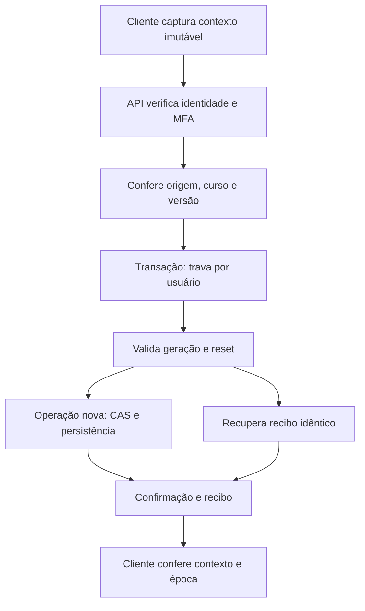

# COM-1 — Desenho técnico da composição segura

> **RELATÓRIO ESTÁTICO DO CODEX — recebido em 23/10/2026 e registrado sem reexecutar a auditoria.** Fonte: relatório apresentado pelo proprietário no chat. A baseline investigada foi `1b1b27908f3babb89b04dac222ed5bbcee7f1ca1` (PR #9 integrada); os fatos de ambiente da COM-0 derivam do [relatório COM-0](RELATORIO_COM0.md), não de nova conexão ao banco.
>
> **Status histórico do relatório:** `COM-1: DECISÕES PENDENTES`. Após a entrega, o proprietário concordou em prosseguir com as **cinco diretrizes de arquitetura** registradas em [DECISOES_COM1.md](DECISOES_COM1.md). Isso **não** equivale a aprovar as seis tabelas `_v2`, os cinco IDs de migração propostos, SQL exato, protocolo de áudio, migração ou implementação.
>
> **Limites:** Codex fez análise estática de código/documentação, com pareceres de QA e Revisor sobre o desenho. Não houve SQL, banco, rede, navegador, build ou implementação. Este arquivo registra evidências relatadas; não inventa logs ou homologação executada.


**O desenho está concluído para avaliação, com decisões pendentes sobre legado, continuidade do EN e acesso ao áudio histórico.** A composição não deve ser iniciada antes dessas decisões.

## 1. Baseline e limites

Confirmei a PR #9 integrada e a `main` em:

`1b1b27908f3babb89b04dac222ed5bbcee7f1ca1`

Foram lidos os documentos obrigatórios nessa referência. O [COM-0](https://github.com/NatanaelSCampos/destrava/blob/1b1b27908f3babb89b04dac222ed5bbcee7f1ca1/docs/features/es-a1-composicao/RELATORIO_COM0.md) foi utilizado como evidência histórica, sem repetir suas consultas.

Também comparei os blobs de oito módulos centrais da baseline com o motor local `e780e56`; coincidem, incluindo B1, serviço I8, provider, cache e repositórios.

**Nesta execução:**

- Nenhum acesso ao Supabase, Docker, credenciais ou Fly.
- Nenhum SQL ou teste executado.
- Nenhum arquivo, configuração ou worktree alterado.
- Nenhuma operação Git de escrita.

O relatório é entregue somente nesta resposta.

## 2. Arquitetura proposta

A composição parte da `main`. Do piloto, entram seletivamente conteúdo e adaptações compatíveis; implementações antigas não substituem o motor atual.



As identidades permanecem distintas:

| Identidade | Finalidade |
|---|---|
| `G` persistida | Barreira de reset da conta |
| Época local | Invalidar callbacks de um contexto anterior |
| Revisão CAS | Impedir sobrescrita concorrente |
| `contentVersion` | Identificar a edição do conteúdo |
| Hash | Fixar as definições efetivamente utilizadas |
| `operationId` | Reconhecer repetição da mesma operação |

**Editar a U2 altera versão/hash do ES. Não incrementa `G`, não reinicializa EN e não cria outro curso pessoal.**

## 3. Contratos internos

Proponho um módulo interno de autoridade, separado dos contratos públicos de pacote:

```ts
// ESBOÇO DOCUMENTAL — NÃO IMPLEMENTADO
type LearningOperationContext = Readonly<{
  protocolVersion: 2;
  intendedUserId: string;
  generation: number;
  source: "compiled" | "installed";
  courseId: string;
  contentVersion: string;
  courseDigest: string;
  operationId: string;

  // Conforme o executor:
  lessonId?: string;
  definitionHash?: string;
  versionSessionId?: string;
  installationId?: string;
  artifactHash?: string;
}>;
```

Regras obrigatórias:

1. Capturar contexto, payload e época local **antes de enfileirar**.
2. Cada request compara `intendedUserId` com o usuário autenticado naquele momento. O servidor deriva o proprietário efetivo.
3. Retries preservam contexto e payload originais.
4. Não preencher geração ausente com `0` ou com a geração atual.
5. Não substituir `InstalledContentReference` nem alterar o contrato público do produtor. A autoridade envolve essa referência em um envelope interno.

A resposta separa:

- **`operationReceipt`**: resultado imutável da operação original.
- **`currentSnapshot`**: estado atual, identificado por contexto e revisão.

Assim, repetir A depois de B recupera o recibo de A sem restaurar o estado anterior a B. Essa regra vale para B1, seleção e progresso I8.

## 4. Geração, transação e reset

### Escrita pessoal

Todos os escritores pessoais devem usar a mesma trava por usuário do protocolo de geração, seed `731984`.

```text
PSEUDOCÓDIGO — NÃO EXECUTADO

verificar chamador autorizado e proprietário
adquirir trava transacional do usuário
ler geração/resetting depois da espera
validar geração e escopo completo

se existe recibo:
    exigir contexto e payload idênticos
    retornar recibo original
senão:
    validar revisão CAS
    persistir efeitos e recibo atomicamente

confirmar transação
```

O desenho exige leitura atual após a trava. A implementação deverá provar esse comportamento sob a configuração transacional escolhida; um snapshot anterior à espera não pode autorizar a operação. Retry de conflito mantém a geração original.

Há recibos também para **abertura de sessão e checkpoints sem tentativa**, cobrindo ACK perdido nesses caminhos.

### Reset administrativo

O reset permanece **somente projetado**, sem endpoint administrativo habilitado nesta composição.

Um journal privado registra:

`operationId + payloadHash + geração esperada/resultante + escopo + fase`

- Início: trava do usuário, reconhecimento de retry idêntico, freeze e incremento atômicos.
- ACK perdido: retorna a geração resultante já registrada; não incrementa novamente.
- Conclusão: verifica operação ativa, geração, fase e disposição confirmada dos objetos envolvidos.
- Falha: mantém freeze.
- Conclusão atrasada de R1 não libera R2.
- Geração nunca diminui; esgotamento do teto falha fechado.

**A geração existente é global por usuário.** Um reset exclusivo do ES não pode ser implementado silenciosamente com esse mecanismo. A evolução editorial não precisa dele.

## 5. Sessões e evidências B1

### Escopo persistido

A sessão atual passa a ser identificada por:

`usuário + G + curso + lição + contentVersion + definitionHash`

Um escopo novo recebe novo UUID. O anterior permanece histórico.

No banco, a alteração proposta inclui:

- Geração e protocolo explícitos nas novas sessões.
- Unicidade correspondente ao escopo completo.
- Contexto persistido nos recibos e FKs coerentes com sessão/proprietário/geração.
- Recibos imutáveis.
- Ajuste conjunto de queries, índices, `ON CONFLICT`, runtime e projeções.

Não basta mudar a chave no frontend.

### Recibos, leitura e replay

O retorno antecipado atual de `segment/route.ts` deve ser substituído por recuperação que valide geração e escopo no protocolo transacional.

A leitura normal da própria sessão continua possível sem exigir a chave do writer, pelo caminho autenticado/RLS. A leitura privilegiada de recibos continua exigindo sua configuração privada.

O carregamento diferencia:

- Ausência atual confirmada.
- Falha de leitura.
- Reset em andamento.
- Geração incompatível.
- Legado aguardando decisão.
- Cliente que precisa atualizar.

Nenhum desses bloqueios pode virar `session: null` com autorização implícita para salvar vazio.

### Edição da U2

O hash atual abrange o pacote inteiro. Uma edição na U2 pode alterar o hash de aulas da U1.

Proposta: **manter esse algoritmo nesta composição** e abrir novo escopo quando necessário. Provas antigas continuam disponíveis como histórico, sem aprovar automaticamente a edição nova.

## 6. Paginação e consistência da recuperação

Ordenação por data e paginação por offset não definem um corte consistente.

Proponho:

1. Um ordinal de recibo atribuído **após adquirir a trava comum**, mantida até o commit.
2. Na abertura do lote, capturar sob essa trava:
   - Watermark `H` dos recibos confirmados.
   - Revisões dos estados mutáveis.
   - Manifesto imutável `lessonId → definitionHash`.
3. Paginação por chave, limitada a `H`.
4. Cursor assinado, vinculado a proprietário, geração, origem, curso, versão, manifesto e posição.
5. Conferência de geração/reset em cada página.
6. Publicação da projeção somente após completar e validar o lote.

Se não houver retenção do snapshot inicial, mudanças no vetor de revisões devem **abortar e reiniciar o lote**. Não combinar estado da revisão 11 com recibos limitados à revisão 10 como se fossem o mesmo corte.

Recibos não podem desaparecer por exclusão/cascata durante esse protocolo. Falha de página não produz recuperação parcialmente concluída.

Isso estabelece uma linearização verificável; não promete retirar bytes já entregues antes de um reset.

## 7. Schema e tratamento por objeto

| Grupo | Alteração proposta | Legado |
|---|---|---|
| `user_learning_generations` | Preservar autoridade; tratar teto mediante preflight autorizado | Não incrementar ou corrigir valores automaticamente |
| Sessões/recibos B1 | Acrescentar escopo persistido, unicidade/FKs e recibos imutáveis | Manter registros sem geração como históricos |
| Seis tabelas pessoais I7/I8 | Contrapartes privadas `_v2` com geração nas identidades/FKs | Preservar tabelas e triggers imutáveis existentes |
| Estado compilado | Snapshot por proprietário, geração, origem, curso, versão e digest | Eliminar fallback automático para estado sem geração |
| Projeções mutáveis | Acrescentar escopo às chaves de progresso, vocabulário, erros e revisão | Não sobrescrever registros antigos |
| Tentativas, submissões e eventos | Contexto persistido, IDs/FKs coerentes e deduplicação por escopo/operação | Não fabricar autoridade retroativa |
| Perfil de identidade da conta | Preservar campos de identidade; separar campos pedagógicos | Fora de reset indiscriminado |
| Catálogo global e consumo | Preservar instalações, ponteiros, artefatos e ledger | Fora da geração pessoal |

As seis contrapartes privadas propostas são:

- `course_version_sessions_v2`
- `course_version_evidence_v2`
- `runtime_course_selections_v2`
- `runtime_selection_operations_v2`
- `installed_study_progress_v2`
- `installed_progress_operations_v2`

O inventário compilado inclui sessões/atividades, progresso, avaliações, tentativas, vocabulário, erros, revisões, submissões, feedback, eventos, estados e perfis pedagógicos. **Antes de COM-2, falta fechar a matriz SQL por tabela com colunas, chaves, FKs, autoridades e grants exatos.**

### Regra para dados sem geração

Recomendação conservadora:

- Preservar fisicamente como histórico.
- Não aplicar `DEFAULT G_atual`.
- Não promover flags antigas a evidência B1.
- Não considerar cache legado autoridade.
- Retornar `LEGACY_REVIEW_REQUIRED`, preservando recuperação.
- Adotar evidência somente mediante regra aprovada por objeto, com proveniência e compatibilidade verificáveis.

**Isso bloqueia o cutover compartilhado até resolver a continuidade do EN.** Preservar os arquivos do inglês não garante, sozinho, preservar seu funcionamento contra um banco cujo protocolo mudou.

## 8. Inventário de RPCs e segurança

### Operações pessoais a versionar e fechar no protocolo antigo

- `save_interactive_lesson_session`
- `i7_session_open`, `i7_session_get`
- `i7_evidence_append`, `i7_evidence_list`
- `i8_selection_get`, `i8_selection_receipt`, `i8_selection_select`
- `i8_progress_read`, `i8_progress_write`
- `i8_version_evidence_list`

O cutover deve revogar execução das assinaturas pessoais antigas, incluindo `service_role`, evitando um caminho alternativo sem geração.

As operações globais de instalação/ativação e `i8_active_list` preservam sua finalidade; não recebem reset pessoal por inferência.

### Privilégios e MFA

- Revogação explícita de `TRUNCATE` de `PUBLIC`, `anon` e `authenticated` nas sessões e proteção equivalente nas novas tabelas.
- Conferência de privilégios efetivos, herança, grants por coluna e defaults dos proprietários criadores.
- Nenhuma alteração indiscriminada de memberships globais.
- Funções privilegiadas com `search_path` vazio e permissões explícitas.
- Preservação de `getAuthenticatedUser → mfa_access_allowed`, incluindo dispositivos confiáveis.
- `auth.uid()` de uma chamada de serviço não substitui o proprietário autenticado pelo servidor.
- Nenhuma credencial no DTO.
- Feedback individual autorizado após submissão permanece; definições privadas e gabaritos antecipados não entram na projeção pública.

## 9. Convergência SQL

Identificadores **propostos, não reservados nem executados**:

| Migração proposta | Responsabilidade |
|---|---|
| `20261023010100_composition_baseline.sql` | Reconhecer estado e registrar proveniência observada |
| `20261023010200_learning_scope_expand.sql` | Expandir estruturas e escopos |
| `20261023010300_learning_rpc_v2.sql` | Introduzir protocolos V2 |
| `20261023010400_learning_cutover_acl.sql` | Fechar escritores antigos e aplicar privilégios |
| `20261023010500_learning_generation_limit.sql` | Aplicar teto após verificação aprovada |

A unicidade desses IDs deverá ser conferida antes da implementação.

### Precondições

O preflight futuro deve confrontar histórico, tipos, constraints, funções, proprietários, políticas, grants, índices e FKs com a matriz aprovada.

O estado local conhecido será reconhecido explicitamente: ambos os conjuntos presentes, histórico apenas B1, constraint sem teto e grants remanescentes.

- Diferença inesperada: **STOP**.
- `IF NOT EXISTS` não comprova equivalência.
- Não renomear nem reaplicar as originais.
- Não alterar `schema_migrations` para simular a origem do reset.
- Registrar objetos herdados como **proveniência não atribuída**, sem inventar autor ou data.

QA deverá cobrir também fixtures `novo`, `reset-only`, `B1-only` e `ambos`.

### Consulta agregada mínima

**ESBOÇO DOCUMENTAL — NÃO EXECUTADO:**

```sql
SELECT count(*) AS valores_acima_do_teto
FROM public.user_learning_generations
WHERE generation > 9007199254740991;
```

A execução requer autorização própria. Resultado maior que zero causa STOP, sem clamp ou reset.

A futura verificação e aplicação da constraint precisam ocorrer com exclusão adequada de escritores, evitando inserir um valor inválido entre a consulta e o DDL.

## 10. Áudio e rede local

### Áudio

Novas gravações devem carregar contexto persistido e caminhos separados por proprietário/geração/curso/versão/operação.

A validação precisa abranger emissão, leitura, download e replay, inclusive áudio armazenado no recibo B1.

**URLs assinadas antigas podem continuar válidas pelo TTL já emitido — atualmente uma hora no repositório examinado.** Alterar `G` não demonstra revogação retroativa.

Proponho avaliar acesso autenticado para novas reproduções, sem URL persistente. Essa adaptação e a política de acesso ao áudio histórico exigem aprovação. O reset permanece desabilitado enquanto isso estiver indefinido.

### Rede

Proposta futura: publicar PostgreSQL explicitamente em `127.0.0.1`, acrescentando `::1` somente se necessário.

- Conferir o mecanismo suportado pela versão instalada do CLI.
- Fortalecer o guard para verificar o endereço de bind.
- Preservar volumes.
- Não presumir firewall nem editar containers temporariamente como solução permanente.

Nenhuma exposição foi testada ou configuração alterada.

## 11. Composição dos módulos

| Frente | Arquivos/módulos envolvidos |
|---|---|
| Autoridade e transporte | Novo módulo interno de contexto; `learning-generation-client.ts` do piloto adaptado; clientes Supabase e endpoint de geração |
| B1 | `domain/interactive-lesson/{server,evidence,session-state,integrity,progress-receipt}.ts`; APIs `session` e `segment` |
| I7/I8 | Serviços de instalações/estudo instalado; contratos internos e repositórios Supabase/HTTP |
| Sincronização | `study-provider.tsx`, `study-progress-sync.ts`, `study-sync-cache.ts`, `supabase-study-repository.ts` |
| Avaliações/A2 | API de avaliações, runner adaptativo, prefixos, lifecycle e projeções canônicas |
| B2/áudio | Integração da aula, controlador de narração e acesso à mídia; preservar arbitragem, pausa e fallback |
| Conteúdo ES | `content/courses/espanhol-a1-pessoal`, fontes/overrides aprovados, builder e verificadores ES |
| Compilação | `compile-content.ts`, registro e artefatos gerados no candidato futuro |

Reutilizar os 21 roteiros e as 44 escutas conforme seus contratos. Não habilitar recursos instalados por transportar DTO compatível. Preservar limite de gravação e não anunciar STT/pronúncia inexistentes.

**O EN permanece intacto em suas worktrees.** Não haverá cópia de seus arquivos, reconstrução de conteúdo ou mudança de versão por consequência do ES.

## 12. Etapas e testes independentes

Todos os testes abaixo são **planejados e não executados**.

| Etapa futura | Entrega pequena | Negativos obrigatórios |
|---|---|---|
| 1 | Matriz SQL/legado por objeto | Estado inesperado interrompe; nenhum histórico fabricado |
| 2 | Contratos e contexto imutável | G ausente/inválida, troca de conta, ABA e fila antiga |
| 3 | Expansão/ACL em banco sintético | DML/TRUNCATE/RPC negados; grants herdados/defaults |
| 4 | Writer e recibos B1 | Reset primeiro/writer primeiro, ACK perdido, payload divergente, CAS |
| 5 | Leitores e recuperação | 501+ recibos, várias lições, reset entre páginas, snapshot divergente |
| 6 | I8 e A2 | Retry A após B, versão fixada, reload, falhas e prefixos canônicos |
| 7 | Conteúdo ES e B2 | U2 altera hash U1; idioma sintético; TTS não concede aprovação |
| 8 | Integração | Auth/MFA/RLS, HTTP/browser, 360/390, TypeScript, lint, arquitetura e build |

Também serão necessários:

- Falhas transacionais sem efeitos parciais.
- Incremento no teto de geração.
- Cache sem G sem POST automático.
- Cliente antigo e overload antigo recusados.
- Preservação de bytes **e comportamento** do EN.
- Nenhuma chamada paga repetida como retry; ledger de consumo preservado.

Lead integra e coordena serviços. Implementador trabalha em escopo delimitado. QA deriva e executa negativos independentemente. Revisor examina candidato congelado.

### Pareceres desta análise

- **QA:** cinco lacunas do primeiro desenho encerradas; inventário por objeto parcialmente encerrado, faltando SQL detalhado. **Decisões pendentes.**
- **Revisor:** inconsistência de snapshots e contrato incompleto de áudio encerrados no desenho revisado; nenhum novo achado técnico aberto no texto examinado. **Decisões pendentes.**

Ambos fizeram somente análise estática. A restrição de leitura foi procedural; não foi comprovado sandbox técnico independente.

## 13. Transição, reversão e decisões

### Transição segura

Expansão isolada → cliente/servidor V2 → janela autorizada de manutenção → fechamento dos escritores V1 → ativação dos leitores V2.

Não usar escrita simultânea pelos dois protocolos. Clientes antigos devem receber erro recuperável de atualização.

### Reversão

Usar cliente compatível, bloqueio efetivo de escrita ou correção adiante. Não reduzir geração, reabrir RPC permissiva, apagar evidências ou derrubar schema para voltar ao código antigo.

### Decisões necessárias

1. **Legado:** aprovar preservação histórica e definir critérios de adoção por objeto.
2. **EN:** definir como manter continuidade antes de qualquer cutover em banco compartilhado.
3. **Proveniência:** aceitar registro explícito dos objetos herdados sem atribuir uma aplicação histórica não demonstrada.
4. **Áudio:** definir acesso histórico e expectativa de revogação após reset.
5. **SQL:** aprovar a matriz final de colunas, chaves, FKs, autoridade e privilégios por tabela.

## 14. Autorizações necessárias antes de implementar

A próxima autorização deverá delimitar:

- Criação de branches/worktrees e alterações de código/documentação.
- Implementação dos contratos internos e adaptações aprovadas.
- Consultas adicionais de preflight e agregado de geração.
- DDL, funções, índices, constraints, RLS e grants específicos.
- Criação de ambiente local sintético isolado e testes com escrita.
- Quaisquer pausas/reinícios de serviços ou mudanças de bind.
- Eventual adoção/migração de dados legados.
- Commit, push e PR, se desejados.

**Aplicação no banco local já existente, reset, merge, operação remota e deploy continuam sendo autorizações separadas.**

COM-2 e a reformulação da U2 não foram iniciados.

**COM-1: DECISÕES PENDENTES**
